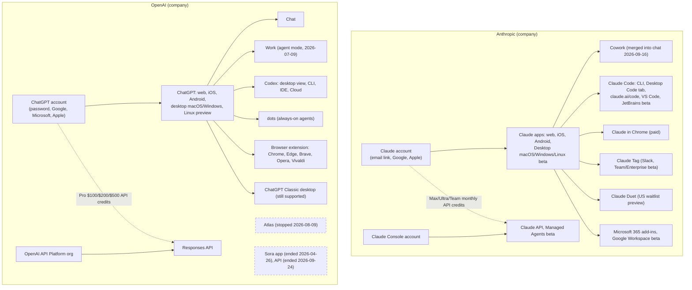
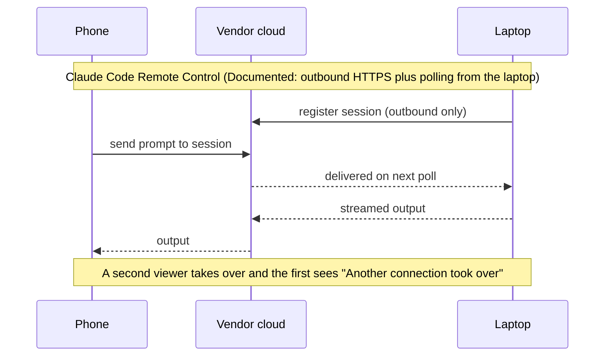
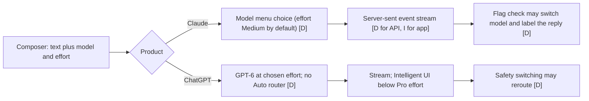
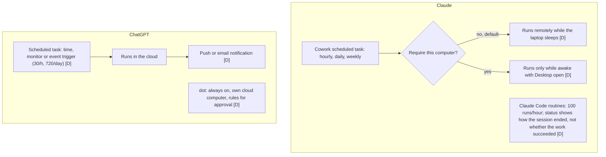
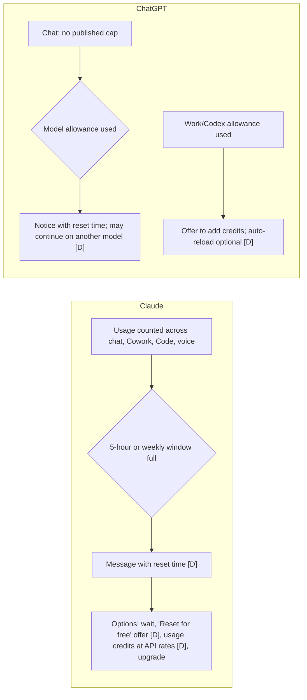

# Claude and ChatGPT compared across every surface

Status: Current research snapshot
Owner: Product research
Last updated: 2026-11-18
Verified: 2026-11-18
Coverage: official Anthropic and OpenAI pages read on 2026-11-18 (OpenAI help and policy pages read in a rendering browser), plus the dated UI captures in `docs/research/`

This file compares Claude and ChatGPT, and their related products, across 21 areas. For ChatGPT
and Claude it supersedes `docs/research/assistant-comparison-2026-11-11.md` wherever the two
disagree; that file stays the record for Gemini and Perplexity. Product decisions still follow
`docs/product/competitive-guidance.md`: before acting on any single claim here, reopen the cited
page.

**Research date: 2026-11-18.** Every source below was read on or before that date. Sources are the official pages cited inline, plus dated observations recorded in this repository under `docs/research/`.

## Bottom line

**Claude and ChatGPT have converged on the same shape: a chat home with an agent mode folded into it, coding agents beside it, and one paid subscription that funds all of it. They now differ mostly in how they divide that work, what they charge for it, and which pieces still live on one device.** ChatGPT splits its app into **Chat, Work and Codex**. All three share one desktop app, and Work and Codex share one usage allowance ([ChatGPT Work and Codex](https://help.openai.com/en/articles/20001275-chatgpt-work-and-codex)). Claude merged **chat and Cowork into "one Claude"** on 2026-09-16. Claude Code keeps a separate session list for each surface, but every surface draws on the same usage limits ([Cowork and chat are one Claude](https://support.claude.com/en/articles/16761823-claude-cowork-and-chat-are-one-claude), [Claude Code with Pro or Max](https://support.claude.com/en/articles/11145838-using-claude-code-with-your-pro-or-max-plan)).

ChatGPT has the wider consumer surface:

- image generation (Images 2.6)
- live voice in CarPlay
- Apple Intelligence integration
- a 59-language interface
- a $8 Go tier
- an always-on agent with its own cloud computer ("dots")

ChatGPT is also retiring features quickly. Removed or scheduled for removal: Atlas, Sora, Canvas, group chats, Pulse, agent mode, custom GPTs and the older voice modes.

Claude is stronger in four areas:

- sandboxed file creation and artifacts
- skills, plugins and connectors (it donated the Agent Skills format to AAIF)
- Claude Code's local, cloud, SSH and WSL environments
- a documented 1M-token context on its newest models

Claude does not generate images. Its interface ships in 11 languages on web and desktop. It documents no consumer MFA or passkey sign-in.

For AGI Workforce, the opening is the two things neither leader offers:

- **a model-agnostic Auto router** (ChatGPT retired automatic switching in Chat on 2026-09-14, and Claude has no router)
- **explicit, visible trust boundaries between local and cloud work**, a point where both leaders document data that stays on one machine but give users no single control to see or move it

## How to read this report

### Status labels

| Label                | Meaning in this report                                                                                      |
| -------------------- | ----------------------------------------------------------------------------------------------------------- |
| **Confirmed**        | Stated on a current official page or release note, or directly observed in a dated repository capture       |
| **Partial**          | Part of the claim is confirmed; the rest rests on a summary, an undated page or a conflicting official page |
| **Limited rollout**  | Official, but gradual, beta, preview, waitlist, regional or plan-limited                                    |
| **Announced**        | Officially scheduled but not yet in effect on 2026-11-18                                                    |
| **Deprecated**       | Officially retired or scheduled for retirement                                                              |
| **Confirmed absent** | An official page states the feature is not available. Not finding a feature never earns this label          |
| **Unverified**       | No official page read supports it. This is not evidence of absence                                          |

For architecture (area 19), each statement is also marked **Documented** (a vendor states it), **Observed** (seen in a repository capture) or **Inference** (my reasoning, not a vendor description).

### Evidence and precedence

- **The first research round** relied partly on search summaries. help.openai.com and openai.com returned HTTP 403 to fetch tools, so most first-round ChatGPT facts were labelled Partial.
- **The verification round** read official pages directly on 2026-11-18. OpenAI pages were read in a real browser, where they loaded. Where the two rounds disagree, **the verification round wins**, and material corrections are flagged as "Correction".
- **The coordinator spot-checked on 2026-11-18** that:
  - claude.com/pricing shows Pro at $20 monthly or $17/month billed annually, Max at $100 (5x Pro, $100 a month in API credits) and Ultra at $200 (no 5-hour limit, 10x Pro weekly, $200 a month in API credits)
  - the ChatGPT release notes date the custom GPT retirement entry 2026-09-11, Atlas stopping on 2026-08-09 and Pro 500 at $500 to 2026-09-29
- **Help-center dates.** Both help centers show relative "Updated N days ago" stamps. Absolute dates come from release notes wherever possible.
- **Product UI.** No signed-in product interface was observed for this report. The only product UI evidence is:
  - the iOS screenshots of 2026-11-12 in `docs/research/mobile-layout-2026-11-12/`
  - the earlier dated web captures in `docs/research/claude-ai-ui-reference-2026-09-03.md`, `docs/research/leader-ui-reference-2026-09-04.md` and `docs/research/leader-observation-2026-09-13.md`
- **Vocabulary.** "Claude" and "ChatGPT" are products; Anthropic and OpenAI are the companies. ChatGPT's "connectors" are now called **apps and plugins** on OpenAI pages, and this report uses that vocabulary for ChatGPT ([Connected apps](https://help.openai.com/en/articles/11487775-connected-apps-in-chatgpt)).

## Area 1: product ecosystem and applications

### Ecosystem map



### Claude-side products and how they connect to Claude

| Product                                             | What it is                                                                                                                                               | Status                                                                                       | Plans                                                               | Account, subscription, usage, tools and data link to Claude                                                                                                                                                                                                                                                                                                                                                                                                                                                    |
| --------------------------------------------------- | -------------------------------------------------------------------------------------------------------------------------------------------------------- | -------------------------------------------------------------------------------------------- | ------------------------------------------------------------------- | -------------------------------------------------------------------------------------------------------------------------------------------------------------------------------------------------------------------------------------------------------------------------------------------------------------------------------------------------------------------------------------------------------------------------------------------------------------------------------------------------------------- |
| **Claude apps** (web, iOS, Android, Desktop)        | Chat plus Cowork agent work in one experience                                                                                                            | Confirmed; unified experience is a gradual rollout                                           | Free, Pro, Max, Ultra, Team, Enterprise                             | Root of the account; one usage pool (5-hour plus weekly windows) ([usage limits](https://support.claude.com/en/articles/11647753-understanding-usage-and-length-limits))                                                                                                                                                                                                                                                                                                                                       |
| **Cowork**                                          | Multi-step non-coding agent over files, apps and tools. GA on macOS/Windows 2026-04-09; web/mobile 2026-07-07; merged into every conversation 2026-09-16 | Confirmed; web/mobile "rolling out"                                                          | Pro, Max, Ultra, Team, Enterprise                                   | Same account and usage. Cloud sessions follow the account; local folders need Desktop open ([Cowork product](https://claude.com/product/cowork), [release notes](https://support.claude.com/en/articles/12138966-release-notes), [Cowork across devices](https://support.claude.com/en/articles/15520349-use-claude-cowork-on-web-desktop-and-mobile))                                                                                                                                                         |
| **Claude Code**                                     | Coding agent: terminal CLI, Desktop Code tab, claude.ai/code cloud sessions, VS Code (1.94+, including Cursor), JetBrains beta                           | Confirmed; JetBrains beta                                                                    | Pro, Max, Ultra, Team, Enterprise, or a Console (API) account       | "All activity in both tools counts against the same limits" as chat. Each surface keeps its own session list ([setup](https://code.claude.com/docs/en/setup), [11145838](https://support.claude.com/en/articles/11145838-using-claude-code-with-your-pro-or-max-plan), [sessions](https://code.claude.com/docs/en/sessions))                                                                                                                                                                                   |
| **Claude in Chrome**                                | Browser extension that acts in tabs; side panel runs as a Cowork session. Beta for all paid plans since 2025-12-18                                       | Confirmed                                                                                    | Paid only                                                           | Same account. The consumer article supports Chrome only; the Claude Code path also works in Edge (see area 18) ([help](https://support.claude.com/en/articles/12012173-get-started-with-claude-in-chrome), [chrome doc](https://code.claude.com/docs/en/chrome))                                                                                                                                                                                                                                               |
| **Claude Tag**                                      | Claude inside Slack with an ephemeral sandbox per conversation. Launched 2026-06-23; legacy Slack bot retired 2026-10-05 for connected workspaces        | Limited rollout (public beta)                                                                | Team, Enterprise                                                    | Billed from an **organization-funded usage balance** with an Owner spend limit, not seat usage. DMs run on the sender's own account ([Claude Tag](https://claude.com/docs/claude-tag), [Claude Code in Slack](https://code.claude.com/docs/en/slack))                                                                                                                                                                                                                                                          |
| **Claude Duet**                                     | Standalone proactive-agent app (iOS, Android, claude.ai), announced 2026-10-21                                                                           | Limited rollout (US waitlist research preview)                                               | Pro, Max, Ultra (the release note says Pro and Max)                 | Shares the plan's usage limits; background checks count ([Introducing Claude Duet](https://claude.com/resources/articles/claude-duet))                                                                                                                                                                                                                                                                                                                                                                         |
| **Microsoft 365 add-ins and Google Workspace**      | Claude for Excel, PowerPoint, Word, Outlook; Google Workspace beta                                                                                       | Confirmed; Workspace beta                                                                    | Varies by add-in                                                    | Same account ([download](https://claude.com/download))                                                                                                                                                                                                                                                                                                                                                                                                                                                         |
| **Claude Meetings, Personal Finance, Project tags** | Meetings joins Google Meet (2026-11-12); Personal Finance US beta (2026-11-05); Project tags (2026-11-06)                                                | Limited rollout                                                                              | Meetings Team/Enterprise; Finance Pro/Max/Ultra US; tags Enterprise | Inside the Claude apps ([release notes](https://support.claude.com/en/articles/12138966-release-notes))                                                                                                                                                                                                                                                                                                                                                                                                        |
| **Claude API (Claude Platform)**                    | Developer API; Managed Agents (beta) adds hosted agents with a managed sandbox                                                                           | Confirmed; Managed Agents beta                                                               | Console account, billed separately                                  | **Separate account type.** Max ($100), Ultra ($200) and Team ($20 per Standard seat, $100 per Premium seat, $500 pooled cap) get monthly API credits that expire each cycle; the credits "can't be used in Claude Code or the apps" ([API overview](https://platform.claude.com/docs/en/api/overview), [monthly API credits](https://support.claude.com/en/articles/17154008-monthly-api-credits-for-max-ultra-and-team-plans), [managed agents](https://platform.claude.com/docs/en/managed-agents/overview)) |
| **Claude Security, Claude Science, Claude Docs**    | Named on the homepage and help center                                                                                                                    | Unverified beyond names (Claude Docs exports to DOCX, PDF and Markdown per a search summary) | Unverified                                                          | Unverified ([claude.com](https://claude.com))                                                                                                                                                                                                                                                                                                                                                                                                                                                                  |

### ChatGPT-side products and how they connect to ChatGPT

| Product                                                                                           | What it is                                                                                                                                                                                                   | Status                                                                                                                                                                                                                                                                            | Plans                                                                                                | Account, subscription, usage, tools and data link to ChatGPT                                                                                                                                                                                                                                                                                                                                                                   |
| ------------------------------------------------------------------------------------------------- | ------------------------------------------------------------------------------------------------------------------------------------------------------------------------------------------------------------ | --------------------------------------------------------------------------------------------------------------------------------------------------------------------------------------------------------------------------------------------------------------------------------- | ---------------------------------------------------------------------------------------------------- | ------------------------------------------------------------------------------------------------------------------------------------------------------------------------------------------------------------------------------------------------------------------------------------------------------------------------------------------------------------------------------------------------------------------------------ |
| **ChatGPT Chat**                                                                                  | Conversation mode on web, iOS, Android and desktop                                                                                                                                                           | Confirmed                                                                                                                                                                                                                                                                         | All, plus logged-out use                                                                             | No published numeric message caps on Free or Go ("unlimited everyday text chats" with abuse guardrails) ([Free Tier FAQ](https://help.openai.com/en/articles/9275245-chatgpt-free-tier-faq))                                                                                                                                                                                                                                   |
| **ChatGPT Work**                                                                                  | Agent for longer tasks: research, connected apps and files, documents, spreadsheets, presentations, Sites, scheduled tasks. Launched 2026-07-09                                                              | Confirmed                                                                                                                                                                                                                                                                         | **All plans on desktop** ("limited" on Free); Plus, Pro, Business, Enterprise, Edu on web and mobile | **Shares pricing, credits and usage limits with Codex**; Business pages state Work and Codex allowances are separate from Chat ([chatgpt.com/work](https://chatgpt.com/work/), [Work and Codex](https://help.openai.com/en/articles/20001275-chatgpt-work-and-codex), [Business limits](https://help.openai.com/en/articles/12003714-chatgpt-business-models-and-limits))                                                      |
| **Codex**                                                                                         | Coding agent: view in the desktop app, CLI (0.170.0 on 2026-11-18), IDE extension, Codex Cloud (2026-09-29), Remote (GA 2026-06-25)                                                                          | Confirmed                                                                                                                                                                                                                                                                         | Free and Go (rolling out), Plus, Pro, Business, Enterprise, Edu                                      | Same allowance as Work. Codex is **not selectable on web or mobile**; mobile reaches desktop Codex chats through the Remote tab ([Codex pricing](https://learn.chatgpt.com/docs/pricing), [cli](https://learn.chatgpt.com/docs/codex/cli), [moving to the new app](https://help.openai.com/en/articles/20001276-moving-to-the-new-chatgpt-desktop-app))                                                                        |
| **New ChatGPT desktop app**                                                                       | Chat, Work and Codex in one app (macOS and Windows 2026-07-09; Linux public preview 2026-08-14)                                                                                                              | Confirmed; Linux Limited rollout                                                                                                                                                                                                                                                  | All                                                                                                  | Same account. Local Work chats stay on the computer ([release notes](https://help.openai.com/en/articles/6825453-chatgpt-release-notes), [Linux guide](https://learn.chatgpt.com/docs/linux/linux-app))                                                                                                                                                                                                                        |
| **ChatGPT Classic**                                                                               | Previous desktop app, kept installed beside the new one                                                                                                                                                      | Confirmed supported. **Correction:** the 2027-01-30 retirement date is press-only (Unverified)                                                                                                                                                                                    | All                                                                                                  | OpenAI says Classic "continues to receive" updates ([20001276](https://help.openai.com/en/articles/20001276-moving-to-the-new-chatgpt-desktop-app), [9to5Mac](https://9to5mac.com/2026/11/02/openai-is-retiring-chatgpt-classic-app-will-soon-combine-chat-and-work-tabs-in-new-app/))                                                                                                                                         |
| **dots**                                                                                          | Always-on agent with its own cloud computer, starting from ChatGPT memory; announced 2026-09-29                                                                                                              | Limited rollout (Pro and Business Premium, 18+, not EEA/CH/UK at launch); GA for Enterprise, Edu and Healthcare, default-on from 2026-11-18                                                                                                                                       | Pro, Business Premium, Enterprise, Edu, Healthcare                                                   | One personal dot per member. Usage was not counted for the first month; Enterprise billing starts 2027-01-14 ([Getting started with your dot](https://help.openai.com/en/articles/20001530-getting-started-with-your-dot))                                                                                                                                                                                                     |
| **Browser extension**                                                                             | Tab mentions and control in Chrome, Edge, Brave, Opera, Vivaldi; side chat in Chrome, Edge, Brave, Vivaldi                                                                                                   | Confirmed (2026-08-31)                                                                                                                                                                                                                                                            | Unverified per plan                                                                                  | Set up from Desktop Settings > Computer Use ([ext](https://learn.chatgpt.com/docs/chrome-extension), [release notes](https://help.openai.com/en/articles/6825453-chatgpt-release-notes))                                                                                                                                                                                                                                       |
| **Space, Pages, Sites, Slides**                                                                   | Space replaces Library for eligible Pro, Business and Enterprise accounts (2026-09-29); Pages with comments; Sites public beta (2026-07-09); Slides (2026-10-16)                                             | Limited rollout                                                                                                                                                                                                                                                                   | Mostly Pro, Business, Enterprise                                                                     | Files and pages shared inside the account ([release notes](https://help.openai.com/en/articles/6825453-chatgpt-release-notes))                                                                                                                                                                                                                                                                                                 |
| **Office, Slack, Teams, WhatsApp, Apple Intelligence**                                            | Word (all plans, 2026-09-17), PowerPoint (GA 2026-07-06), Excel and Google Sheets; @ChatGPT in Slack and Teams (Enterprise); WhatsApp back in the EEA (2026-07-13); Siri, Writing Tools, Visual Intelligence | Confirmed                                                                                                                                                                                                                                                                         | Varies                                                                                               | Excel and Sheets on Plus and Pro share Codex limits; Apple integration works without an account ([release notes](https://help.openai.com/en/articles/6825453-chatgpt-release-notes), [Apple Intelligence](https://help.openai.com/en/articles/10269382-setting-up-chatgpt-with-apple-intelligence))                                                                                                                            |
| **OpenAI API**                                                                                    | Responses API; Assistants API retired                                                                                                                                                                        | Confirmed                                                                                                                                                                                                                                                                         | Platform org, billed separately                                                                      | Pro tiers include $100, $200 or $500 monthly API credits; Business up to $500. ChatGPT credits "are not API credits" ([api](https://developers.openai.com/api/docs), [Pro tiers](https://help.openai.com/en/articles/9793128-about-chatgpt-pro-tiers), [credits](https://help.openai.com/en/articles/12642688-using-credits-for-flexible-usage-in-chatgpt-personal-plans))                                                     |
| **Atlas**                                                                                         | ChatGPT browser                                                                                                                                                                                              | **Deprecated**: stopped 2026-08-09; bookmarks, tabs and history did not transfer automatically                                                                                                                                                                                    | n/a                                                                                                  | Replaced by the desktop app's built-in browser and the extension ([release notes 2026-07-09](https://help.openai.com/en/articles/6825453-chatgpt-release-notes), [Atlas retirement](https://help.openai.com/en/articles/20001371-chatgpt-atlas-retirement))                                                                                                                                                                    |
| **Sora**                                                                                          | Video app and API                                                                                                                                                                                            | **Deprecated**: web and app ended 2026-04-26; API ended 2026-09-24; purchased credits usable in Codex                                                                                                                                                                             | n/a                                                                                                  | Export at sora.chatgpt.com/sunset ([Sora discontinuation](https://help.openai.com/en/articles/20001152-what-to-know-about-the-sora-discontinuation))                                                                                                                                                                                                                                                                           |
| **Agent mode and Operator, Pulse, group chats, custom GPTs, Canvas, Advanced and Standard Voice** | Earlier ChatGPT features                                                                                                                                                                                     | **Deprecated**: agent "no longer available" (date Unverified); Pulse sunset 2026-06-17; group chat creation ended 2026-07-09; custom GPTs retire 2026-12-11 (Announced, FedRAMP 2027-02-11); Canvas removed 2026-05-28; Advanced and Standard Voice retire 2026-12-11 (Announced) | n/a                                                                                                  | GPTs migrate to plugins (instructions become a skill, knowledge becomes reference files, custom actions do not carry over) ([agent](https://help.openai.com/en/articles/11752874-chatgpt-agent), [GPT retirement FAQ](https://help.openai.com/en/articles/20001519-custom-gpt-retirement-and-migration-faq), [voice retirement](https://help.openai.com/en/articles/20001638-retiring-advanced-and-standard-voice-in-chatgpt)) |

### Same idea, different name; same name, different behavior

| Claude                                   | ChatGPT                                     | Behavioral difference                                                                                                                                                                                                                                                                                               |
| ---------------------------------------- | ------------------------------------------- | ------------------------------------------------------------------------------------------------------------------------------------------------------------------------------------------------------------------------------------------------------------------------------------------------------------------- |
| Cowork (inside chat)                     | Work (Chat \| Work toggle)                  | Claude merged the modes into one conversation; ChatGPT keeps a visible toggle and a separate Work/Codex allowance                                                                                                                                                                                                   |
| Incognito chat                           | Temporary chat                              | ChatGPT temporary chats can be **personalized** (use memory) and **saved** (2026-08-27); Claude incognito opens in the older experience ([incognito](https://support.claude.com/en/articles/12260368-use-incognito-chats), [temporary chat](https://help.openai.com/en/articles/8914046-temporary-chat-in-chatgpt)) |
| Research                                 | Deep research                               | ChatGPT shows a plan review, site restriction and MD/DOCX/PDF export; Claude documents none of these for Research                                                                                                                                                                                                   |
| Artifacts and custom visuals             | Writing blocks, code blocks, Intelligent UI | Claude artifacts persist in a side panel with storage; ChatGPT blocks live inline in the reply                                                                                                                                                                                                                      |
| Projects                                 | Projects                                    | Claude project sharing is Team/Enterprise only; ChatGPT shares projects on every plan, including Free (5 collaborators)                                                                                                                                                                                             |
| Skills                                   | Skills                                      | Claude skills are on all plans; ChatGPT skills sit inside plugins, and GPT instructions migrate into skills                                                                                                                                                                                                         |
| Connectors, plugins                      | Apps, plugins                               | ChatGPT renamed connectors to apps inside plugins (2026-07-09)                                                                                                                                                                                                                                                      |
| Claude Code Remote Control               | Codex Remote, "Control this Mac or PC"      | Both reach a local session from the phone ([remote-control](https://code.claude.com/docs/en/remote-control))                                                                                                                                                                                                        |
| CLAUDE.md                                | AGENTS.md (32 KiB cap)                      | Same role: repository instructions for the coding agent                                                                                                                                                                                                                                                             |
| Permission modes auto, bypassPermissions | Approve for me, Full access                 | Codex sandbox is on by default; Claude Code sandbox is off by default ([sandboxing](https://code.claude.com/docs/en/sandboxing))                                                                                                                                                                                    |
| Ultra ($200)                             | Pro 200 ($200)                              | Ultra has no 5-hour limit for verified accounts; ChatGPT Pro has no 5-hour Codex limit                                                                                                                                                                                                                              |
| Scheduled (Cowork tasks, routines)       | Scheduled tasks                             | ChatGPT adds event triggers (Gmail, Slack, GitHub, webhooks)                                                                                                                                                                                                                                                        |
| Duet                                     | dots                                        | Both are proactive agents; dots own a cloud computer and a Wallet                                                                                                                                                                                                                                                   |

## Surface-by-surface comparison

Each table compares the two products on one surface. Details that both products share across surfaces are covered later under the shared-systems areas.

### Web

| Aspect                    | Claude (claude.ai)                                                                                                                                                                                     | ChatGPT (chatgpt.com)                                                                                                                                                                                                                                                                                     |
| ------------------------- | ------------------------------------------------------------------------------------------------------------------------------------------------------------------------------------------------------ | --------------------------------------------------------------------------------------------------------------------------------------------------------------------------------------------------------------------------------------------------------------------------------------------------------- |
| Home                      | Serif greeting, centered composer about 660 px wide, no top bar, no suggestion chips on an account with history. Confirmed (observed 2026-09-03, `docs/research/claude-ai-ui-reference-2026-09-03.md`) | Chat \| Work segmented control in the header, Temporary chat button. Logged-out mobile web shows a centered composer (2026-06-08). Confirmed (observed 2026-09-04, `docs/research/leader-ui-reference-2026-09-04.md`; [release notes](https://help.openai.com/en/articles/6825453-chatgpt-release-notes)) |
| Logged-out use            | Unverified                                                                                                                                                                                             | One conversation at a time, kept only in the session. Confirmed ([home page](https://help.openai.com/en/articles/9125172-the-chatgpt-home-page))                                                                                                                                                          |
| Search shortcut           | No official chat shortcut list. Unverified                                                                                                                                                             | Cmd/Ctrl+K opens Search. Confirmed ([finding chats](https://help.openai.com/en/articles/10056348-finding-your-chats-projects-and-files-in-chatgpt))                                                                                                                                                       |
| Long chats                | Auto-summarization when code execution is on. Confirmed ([limits](https://support.claude.com/en/articles/11647753-understanding-usage-and-length-limits))                                              | Long chats load in sections (2026-08-21); "Context window full" ends the chat and offers a new chat with a summary. Confirmed ([Free FAQ](https://help.openai.com/en/articles/9275245-chatgpt-free-tier-faq))                                                                                             |
| Exclusive to this surface | Share with specific people (web only); data export (web and Desktop only)                                                                                                                              | Branch in new chat (web, 2025-09-04); Contrast setting (web and Windows)                                                                                                                                                                                                                                  |

### iOS

| Aspect                   | Claude                                                                                                                                                                                                                                                                                                                                                                                      | ChatGPT                                                                                                                                                                                                                                                                                                                                                                          |
| ------------------------ | ------------------------------------------------------------------------------------------------------------------------------------------------------------------------------------------------------------------------------------------------------------------------------------------------------------------------------------------------------------------------------------------- | -------------------------------------------------------------------------------------------------------------------------------------------------------------------------------------------------------------------------------------------------------------------------------------------------------------------------------------------------------------------------------- |
| Listing                  | v1.261116.19, 195.8 MB, iOS/iPadOS 18+, age 18+, 34 languages. Confirmed ([App Store](https://apps.apple.com/us/app/claude-by-anthropic/id6473753684))                                                                                                                                                                                                                                      | v1.2026.307 (2026-11-10), 312.4 MB, iOS 18+ and visionOS, age 13+, English plus 59 languages. Confirmed ([App Store](https://apps.apple.com/us/app/chatgpt/id6448311069))                                                                                                                                                                                                        |
| In-app prices            | Pro $20 monthly, Pro annual $214.99, **Max $124.99, Ultra $249.99** (about 25% above web); credit packs $20 to $700. Confirmed (same listing)                                                                                                                                                                                                                                               | Store-billed in local currency; a store-versus-web premium is Unverified ([multi-currency](https://help.openai.com/en/articles/10421635-multicurrency-billing))                                                                                                                                                                                                                  |
| Navigation               | Menu opens destinations: Projects, Code, Cowork, Artifacts tabs. Partial (observed 2026-11-12, `docs/research/mobile-layout-2026-11-12/screen-map.md`)                                                                                                                                                                                                                                      | 330 pt drawer: Explore, Projects, Plugins, Images, Sites, Health, Finances, Customize, Space, Scheduled, Codex, "Your dot"; Pinned and Recents. Confirmed (observed 2026-11-12, `chatgpt-part-1.md`)                                                                                                                                                                             |
| Model and effort control | Model chip inside the focused composer (for example "Haiku 5.5 / Low"). The help page says "top of the screen on mobile": conflict                                                                                                                                                                                                                                                          | Picker at the top of the conversation: Instant, Medium, High, Extra High, Pro (2026-06-10). Confirmed                                                                                                                                                                                                                                                                            |
| System integration       | App Intents, Shortcuts, widget, "Analyze Photo" control, Lock Screen, Control Center, Action Button, Reminders (iOS only). Confirmed ([intents](https://support.claude.com/en/articles/10263469-using-claude-app-intents-shortcuts-and-widgets-on-ios), [lock](https://support.claude.com/en/articles/10302511-access-claude-for-ios-on-your-lock-screen-control-center-and-action-button)) | Apple Intelligence (Siri, Writing Tools, Visual Intelligence), Live Activities for voice, CarPlay (iOS 26.4+). Confirmed. App widget and Shortcuts: Unverified on OpenAI pages ([Apple Intelligence](https://help.openai.com/en/articles/10269382-setting-up-chatgpt-with-apple-intelligence), [CarPlay](https://help.openai.com/en/articles/20001153-using-chatgpt-in-carplay)) |
| Account switching        | Multiple accounts reported 2026-10-29 by press. Unverified ([iPhone in Canada](https://www.iphoneincanada.ca/2026/10/29/claude-iphone-carplay-voice-mode/))                                                                                                                                                                                                                                 | Up to 2 accounts, each with its own chats and memory (2026-10-30). Limited rollout                                                                                                                                                                                                                                                                                               |

### Android

| Aspect       | Claude                                                                                                                                                                                                                                                                                                                                                                                                                         | ChatGPT                                                                                                                                                                                           |
| ------------ | ------------------------------------------------------------------------------------------------------------------------------------------------------------------------------------------------------------------------------------------------------------------------------------------------------------------------------------------------------------------------------------------------------------------------------ | ------------------------------------------------------------------------------------------------------------------------------------------------------------------------------------------------- |
| Minimum OS   | Android 8.0+. Confirmed ([install](https://support.claude.com/en/articles/9612887-install-claude-for-android))                                                                                                                                                                                                                                                                                                                 | Unverified (Play listing not readable)                                                                                                                                                            |
| Integrations | Messages and email drafting, calendar, alarms and timers (all plans); location and Maps (not Team or Enterprise); Health Connect (Pro/Max/Ultra, Android 14+, US); widget with Chat, Camera, Mic. Reminders are iOS-only. Confirmed ([Android apps](https://support.claude.com/en/articles/11869629-use-claude-with-android-apps), [widget](https://support.claude.com/en/articles/10534883-use-the-claude-widget-on-android)) | Long-press send to pick a model for one message (paid); inline mentions; sticky dictation button; eight recent chats in the sidebar (v1.2026.216+). Default-assistant support in 2026: Unverified |
| Parity notes | Not documented as a full match for iOS                                                                                                                                                                                                                                                                                                                                                                                         | Pinned Codex chats sync to iOS but **not Android** (2026-08-20). Confirmed                                                                                                                        |

### macOS

| Aspect           | Claude Desktop                                                                                                                                                                                                     | ChatGPT desktop app                                                                                                                                                                                                                                                                                  |
| ---------------- | ------------------------------------------------------------------------------------------------------------------------------------------------------------------------------------------------------------------ | ---------------------------------------------------------------------------------------------------------------------------------------------------------------------------------------------------------------------------------------------------------------------------------------------------- |
| Requirement      | macOS 13+ (Quick Entry article says 12+: conflict; 13 governs) ([install](https://support.claude.com/en/articles/10065433-installing-claude-desktop))                                                              | macOS 14+, Apple Silicon or Intel per the help article, which may describe Classic ([9275200](https://help.openai.com/en/articles/9275200-downloading-the-chatgpt-macos-app))                                                                                                                        |
| Launcher         | **Quick Entry**: double-tap Option, attaches a screenshot or a window; Caps Lock dictation (macOS 14+) ([quick entry](https://support.claude.com/en/articles/12626668-use-quick-entry-with-claude-desktop-on-mac)) | Quick chat Cmd+Option+N (another OpenAI page says "Not available" in the ChatGPT view: conflict); Appshot by pressing Cmd twice; Pets; Classic's Chat Bar on Option+Space ([commands](https://learn.chatgpt.com/docs/reference/commands), [use-chatgpt](https://learn.chatgpt.com/docs/use-chatgpt)) |
| Computer control | Computer use: macOS 14+, Pro/Max/Ultra, research preview, per-app tiers ([computer use](https://support.claude.com/en/articles/14128542-let-claude-use-your-computer-in-cowork))                                   | Computer Use in Work and Codex; Computer History (off by default; Pro, Business, Enterprise)                                                                                                                                                                                                         |
| Release channel  | Stable (default) and Latest (about one build a day) from 2026-11-17                                                                                                                                                | Unverified                                                                                                                                                                                                                                                                                           |

### Windows

| Aspect                  | Claude                                                          | ChatGPT                                                                                                                                                                                                                                   |
| ----------------------- | --------------------------------------------------------------- | ----------------------------------------------------------------------------------------------------------------------------------------------------------------------------------------------------------------------------------------- |
| Requirement and install | Windows 10+, x64 and ARM64, installer or Microsoft Store        | Microsoft Store or `winget install --id 9PLM9XGG6VKS -s msstore`; native PowerShell sandbox or WSL2 ([Windows app](https://learn.chatgpt.com/docs/windows/windows-app)). The older help article says Windows 10 build 17763+ and is stale |
| Quick launch            | **Confirmed absent**: "Quick entry is not available on Windows" | Companion window on Alt+Space (stale article); Appshot with both Alt keys                                                                                                                                                                 |
| Computer use            | Supported (Pro/Max/Ultra)                                       | Supported (Codex computer use on Windows since 2026-05-29)                                                                                                                                                                                |

### Linux

| Aspect                   | Claude Desktop                                                                                                                                         | ChatGPT desktop                                                                                                                                                                            |
| ------------------------ | ------------------------------------------------------------------------------------------------------------------------------------------------------ | ------------------------------------------------------------------------------------------------------------------------------------------------------------------------------------------ |
| Status and distributions | Beta: Ubuntu 22.04+, Debian 12+, x64/arm64, apt                                                                                                        | Public preview since 2026-08-14: Ubuntu 24.04/26.04, Debian 13, Fedora 43/44, Arch; .deb, .rpm, Arch script; x64 and ARM64 ([Linux guide](https://learn.chatgpt.com/docs/linux/linux-app)) |
| Gaps                     | No computer use, no dictation. Cowork needs KVM, about 25 GB disk and 8 GB RAM. Release channels not on Linux. Chat on all plans; Code and Cowork paid | Computer Use "not yet" on Linux; browser actions work; Wayland experimental                                                                                                                |

### Browser extensions

| Aspect       | Claude in Chrome                                                                                               | ChatGPT extension                                                                        |
| ------------ | -------------------------------------------------------------------------------------------------------------- | ---------------------------------------------------------------------------------------- |
| Browsers     | Chrome only (consumer help); Chrome and Edge, with Brave, Arc, Vivaldi and Opera detected, through Claude Code | Chrome, Edge, Brave, Opera, Vivaldi; side chat in Chrome, Edge, Brave, Vivaldi           |
| Plans        | Paid plans only                                                                                                | Unverified                                                                               |
| Model        | Acts in the user's real browser; side panel is a Cowork session; about 15 permissions                          | Tab mentions and control from the desktop app; set up in Desktop Settings > Computer Use |
| Upload limit | 10 MB per upload through Claude Code ([chrome doc](https://code.claude.com/docs/en/chrome))                    | Unverified                                                                               |

### CLI

| Aspect          | Claude Code CLI                                                                             | Codex CLI                                                                                                                              |
| --------------- | ------------------------------------------------------------------------------------------- | -------------------------------------------------------------------------------------------------------------------------------------- |
| Install         | Script, Homebrew, WinGet, apt/dnf/apk, npm ([setup](https://code.claude.com/docs/en/setup)) | Version 0.170.0 on 2026-11-18 ([cli](https://learn.chatgpt.com/docs/codex/cli), [changelog](https://learn.chatgpt.com/docs/changelog)) |
| Access          | Paid plan or Console account                                                                | ChatGPT plan, or an API key that gets **no cloud** ([pricing](https://learn.chatgpt.com/docs/pricing))                                 |
| Release cadence | Every 1 to 2 weekdays ([changelog](https://code.claude.com/docs/en/changelog))              | Unverified                                                                                                                             |

### IDE

| Aspect               | Claude Code                                                                                                                                                               | Codex                                                                        |
| -------------------- | ------------------------------------------------------------------------------------------------------------------------------------------------------------------------- | ---------------------------------------------------------------------------- |
| Editors              | VS Code 1.94+ including Cursor and Open VSX ([vs-code](https://code.claude.com/docs/en/vs-code)); JetBrains beta ([jetbrains](https://code.claude.com/docs/en/jetbrains)) | Extension `openai.chatgpt` ([ide](https://learn.chatgpt.com/docs/codex/ide)) |
| Shared configuration | MCP scopes and settings precedence                                                                                                                                        | MCP shared across desktop, CLI and IDE, **not with web**                     |

### Cloud coding

| Aspect  | Claude Code on the web                                                                                                              | Codex Cloud                                                                                                                                                                                     |
| ------- | ----------------------------------------------------------------------------------------------------------------------------------- | ----------------------------------------------------------------------------------------------------------------------------------------------------------------------------------------------- |
| VM      | 4 vCPU, 16 GB, 30 GB disk; network None, Limited or Full ([cloud-environments](https://code.claude.com/docs/en/cloud-environments)) | Plus 2 vCPU/8 GiB; Pro and above 4 vCPU/16 GiB/32 GB; state recoverable for 7 days                                                                                                              |
| Cost    | No separate VM charge; same usage limits                                                                                            | Same Work/Codex allowance                                                                                                                                                                       |
| Handoff | `--cloud`, `--teleport` (one-way copy), Open in > Cloud carries a summary                                                           | Starts from desktop, web or mobile and keeps running while the computer sleeps; local-to-cloud handoff unsupported ([remote-connections](https://learn.chatgpt.com/docs/remote-connections.md)) |

## Shared systems, areas 2 to 7

### Area 2: screens, navigation and interface elements

| Element              | Claude                                                                                                                                                                                                                                 | ChatGPT                                                                                                                                                                                                                                        | Label                                                                     |
| -------------------- | -------------------------------------------------------------------------------------------------------------------------------------------------------------------------------------------------------------------------------------- | ---------------------------------------------------------------------------------------------------------------------------------------------------------------------------------------------------------------------------------------------- | ------------------------------------------------------------------------- |
| Web sidebar order    | Chat and Cowork / Code toggle; New; Projects; Artifacts; Scheduled; Customize; project list; "Chats and tasks" with a filter (Type, Status, Last activity, Group by, Sort by); Design; account row with Get apps, Search, Hide sidebar | Search; New chat; Library; Scheduled; Plugins; More (Images, Health, Finances, Sites, GPTs); Projects; Chats; profile and Download apps. Work chats carry a "Work" badge                                                                       | Confirmed (observed 2026-09-03/04, `docs/research/`)                      |
| Collapsed state      | Hide sidebar                                                                                                                                                                                                                           | Icon rail at 1336 px                                                                                                                                                                                                                           | Confirmed (observed 2026-09-13)                                           |
| Chat row menu        | Pin, Rename, Add to project, Move to group, Delete                                                                                                                                                                                     | Share, Rename, Pin, Archive, Delete, Move to project. The delete dialog warns that memories saved during the chat are not deleted                                                                                                              | Confirmed (observed)                                                      |
| Title dropdown       | Pin (P), Rename (R), Add to project, Delete (D). Cowork adds Schedule, Turn into skill, Copy session ID, Archive (A)                                                                                                                   | Unverified                                                                                                                                                                                                                                     | Confirmed (observed 2026-09-04)                                           |
| Account menu         | Settings, Language, Get help, plan, Get apps, Claude Academy, Learn more, Get API keys, Log out                                                                                                                                        | Profile menu                                                                                                                                                                                                                                   | Confirmed (observed)                                                      |
| Settings sections    | General, Account, Privacy, Billing, Usage, Capabilities, Claude Code, Cowork, Claude in Chrome. Customize holds Skills, Connectors, Plugins                                                                                            | General (Appearance, Contrast, Accent, Language, Dictation), Notifications, Personalization, Plugins, Voice, Billing, Usage, Data controls, Cloud browser, Storage, Safety, Security and login, Parental controls                              | Confirmed (observed)                                                      |
| Desktop-only screens | Code tab (environment, folder, permission and model row)                                                                                                                                                                               | Activity view behind a bell (unread, running, waiting; filters Work, Chat, Pinned, Scheduled; Mark all as read) ([notifications](https://learn.chatgpt.com/docs/notifications))                                                                | Confirmed                                                                 |
| Command palette      | Unverified                                                                                                                                                                                                                             | Cmd/Ctrl+K or Cmd+Shift+P; Cmd+/ lists shortcuts                                                                                                                                                                                               | Confirmed ([commands](https://learn.chatgpt.com/docs/reference/commands)) |
| Visual settings      | Appearance; chat font (Default, System, Dyslexic friendly); Motion                                                                                                                                                                     | Appearance (System, Light, Dark); Contrast (System, Medium, Increased; web and Windows only); Accent color; Text size (Windows) ([visual experience](https://help.openai.com/en/articles/11958281-updating-your-visual-experience-on-chatgpt)) | Confirmed                                                                 |

**Keyboard shortcuts.** The full ChatGPT desktop table is official. Selected entries:

- Cmd+N: new chat
- Cmd+Shift+N: temporary chat
- Cmd+Shift+A: archive
- Cmd+Shift+U: mark unread
- Cmd+Option+P: pin
- Cmd+Option+R: rename
- Cmd+F: find
- Ctrl+Shift+M: model picker
- Ctrl+Shift+V: voice
- Ctrl+1/2/3: switch Chat, Work, Codex
- Cmd+T: browser tab
- Cmd+Option+L: copy deep link
- Cmd twice: Appshot

"Search chats" has **no default desktop shortcut** ([commands](https://learn.chatgpt.com/docs/reference/commands)).

Claude has **no official chat shortcut page**. Official shortcut references exist only for Claude Docs, artifact keyboard navigation (F6, Tab, Escape) and Claude Code ([artifacts with a keyboard](https://support.claude.com/en/articles/17457950-use-artifacts-with-a-keyboard-or-screen-reader)). Claude's Cmd+U (attach) and the title-menu letter keys are observed only.

### Area 3: composer and input controls

| Control                | Claude                                                                                                                                                                                                                                                  | ChatGPT                                                                                                                                                                                                                                                                                                                           |
| ---------------------- | ------------------------------------------------------------------------------------------------------------------------------------------------------------------------------------------------------------------------------------------------------- | --------------------------------------------------------------------------------------------------------------------------------------------------------------------------------------------------------------------------------------------------------------------------------------------------------------------------------- |
| Placeholder            | "How can I help you today?" (web); "Chat with Claude" / "Type or hold to talk" (iOS)                                                                                                                                                                    | "Ask ChatGPT" (iOS); "Do anything. @ to use plugins" (desktop)                                                                                                                                                                                                                                                                    |
| Enter and newline      | Enter sends, Shift+Enter adds a newline (web, observed)                                                                                                                                                                                                 | Desktop setting: Enter sends, or require Cmd/Ctrl+Enter for multiline or for every prompt ([settings](https://learn.chatgpt.com/docs/reference/settings))                                                                                                                                                                         |
| "+" menu               | Web: Add files or photos (Cmd+U), Take a screenshot, Add to project, Skills, Add connector, Add plugins, Research, Web search, Memory. iOS "Add to Chat" sheet: Camera, photo strip, Add files, Add to project, Research, Connectors, Memory (observed) | Official items: Add from library (2026-08-07), press-and-hold "+" for recent photos on iOS (2026-08-21). A community report lists Camera, Photos, Files, Create image, Sketch, Thinking, Deep research, Web search, Visualize, Plugins (Partial; [community](https://community.openai.com/t/rethinking-the-chatgpt-menu/1409856)) |
| Slash and mention      | "/" opens skills                                                                                                                                                                                                                                        | Desktop: /model, /reasoning, /fast, /plan, /side, /compact, /fork, /memories, /status, /usage; $ invokes skills, @ invokes plugins ([slash](https://learn.chatgpt.com/docs/reference/slash-commands)); web "/" starts Search or Deep research                                                                                     |
| Long paste             | Third-party claim of about 20,000 characters. Unverified                                                                                                                                                                                                | Over 10,000 characters becomes an attachment on all plans (since 2026-08-04); "Show in text field" reverts it. Confirmed                                                                                                                                                                                                          |
| Sending during a reply | Unverified                                                                                                                                                                                                                                              | Desktop "Follow-up behavior" setting: steer the current run or queue for the next. Confirmed                                                                                                                                                                                                                                      |
| Predictions            | Unverified                                                                                                                                                                                                                                              | Codex desktop suggests the next message; Tab accepts it ([composer predictions](https://learn.chatgpt.com/docs/features/composer-predictions))                                                                                                                                                                                    |
| Dictation              | Mobile, 12 languages, non-English in beta, all plans, audio deleted after transcription ([dictation](https://support.claude.com/en/articles/10065434-use-dictation-on-claude-mobile)); Desktop Caps Lock (macOS 14+)                                    | **Live Dictation** (2026-11-18): text appears as you speak; 10-minute limit removed; all plans and surfaces. Limited rollout                                                                                                                                                                                                      |
| Voice conversation     | Voice mode beta, all plans; Hands free or Push to talk; Fable not available in voice; counts toward usage ([voice](https://support.claude.com/en/articles/11101966-use-voice-mode))                                                                     | Live (GPT-Live-1.1); rolling 24-hour limits: Go 3 h, Plus 3 h, Pro $100 15 h, Pro $200 unlimited; one voice chat at a time; plugins usable but approval is on screen; Advanced and Standard retire 2026-12-11 ([ChatGPT Voice](https://help.openai.com/en/articles/20001274-chatgpt-voice))                                       |
| Draft persistence      | Unverified                                                                                                                                                                                                                                              | Unverified                                                                                                                                                                                                                                                                                                                        |

### Area 4: conversations and message actions

| Action                 | Claude                                                                                                                                                                                                                                                                                                                                                              | ChatGPT                                                                                                                                                                                                                                                                                                                      | Label                |
| ---------------------- | ------------------------------------------------------------------------------------------------------------------------------------------------------------------------------------------------------------------------------------------------------------------------------------------------------------------------------------------------------------------- | ---------------------------------------------------------------------------------------------------------------------------------------------------------------------------------------------------------------------------------------------------------------------------------------------------------------------------- | -------------------- |
| Rename and delete      | Rename and delete; bulk delete on web and Android; purged within 30 days; no documented restore; deleting a chat does not delete memory ([8230524](https://support.claude.com/en/articles/8230524-delete-or-rename-a-conversation))                                                                                                                                 | Delete is permanent and cannot be restored; Archive (restore from Data controls); Archive all and Delete all                                                                                                                                                                                                                 | Confirmed            |
| Pin                    | Pin (web, observed); projects can be starred                                                                                                                                                                                                                                                                                                                        | Pin chats and projects (2026-06-18)                                                                                                                                                                                                                                                                                          | Confirmed            |
| Search past chats      | Sidebar filter; plus a paid-only "search past chats" retrieval tool. Search excludes older Cowork tasks in the unified experience                                                                                                                                                                                                                                   | Chats, projects, images, files and Google Drive; filters All, Chats, Images, Documents, Projects; archived chats included; locked chats excluded                                                                                                                                                                             | Confirmed            |
| Locked chats           | Unverified                                                                                                                                                                                                                                                                                                                                                          | 4-digit PIN or device authentication; resetting the PIN **permanently deletes** locked chats; not end-to-end encrypted (2026-10-20) ([locked chats](https://help.openai.com/en/articles/20001411-using-locked-chats-in-chatgpt))                                                                                             | Limited rollout      |
| Branching              | **Confirmed absent in the unified experience** ("Branching a conversation" from an earlier point "isn't available"); older edit-branch arrows rest on third-party descriptions only                                                                                                                                                                                 | "Branch in new chat" on web (2025-09-04); desktop fork from an earlier message. The version-arrow removal is community-reported (Unverified)                                                                                                                                                                                 | Mixed                |
| Response actions       | Copy, Read aloud, thumbs up, thumbs down (2026-09-13); user turn: Retry, Edit, Copy (observed)                                                                                                                                                                                                                                                                      | Copy, thumbs, comment, share, Switch model, and More (timestamp, View sources, Branch in new chat, Read aloud) (observed)                                                                                                                                                                                                    | Confirmed (observed) |
| Model switch on flag   | Toggle "Switch models when a message is flagged"; the reply is labelled with the model that answered ([17161993](https://support.claude.com/en/articles/17161993-why-claude-switched-models-in-your-conversation-with-sonnet-5-5))                                                                                                                                  | Safety switching remains after automatic switching was retired                                                                                                                                                                                                                                                               | Confirmed            |
| Share links            | Snapshot; artifacts included, files excluded; unshare; Team/Enterprise share in-org. Share with specific people: web only, view-only, invites expire after 30 days ([share](https://support.claude.com/en/articles/10593882-how-to-share-and-unshare-a-chat), [specific people](https://support.claude.com/en/articles/16762496-share-a-chat-with-specific-people)) | chatgpt.com/share/ snapshot, "Update link", no expiry, no per-recipient control, anonymous by default; workspace links update live; a single response can be shared; revoke under Data controls > Shared links ([sharing](https://help.openai.com/en/articles/7925741-sharing-conversations-and-scheduled-tasks-in-chatgpt)) | Confirmed            |
| Temporary or incognito | Incognito cannot be saved; opens in the older experience                                                                                                                                                                                                                                                                                                            | Personalized or Unpersonalized, chosen before the first message; creates no memories; can be saved; 30-day safety copy                                                                                                                                                                                                       | Confirmed            |
| Export                 | Web and Desktop; emailed link valid 24 h; uploaded files excluded ([export](https://support.claude.com/en/articles/9450526-export-your-claude-data))                                                                                                                                                                                                                | ZIP; link expires 24 h after receipt; personal plans only; saved memories not named in the contents ([export](https://help.openai.com/en/articles/7260999-exporting-your-chatgpt-history-and-data))                                                                                                                          | Confirmed            |

### Area 5: content types and rendering

| Content                         | Claude                                                                                                                                                                                                                                                                                                               | ChatGPT                                                                                                                                                                                                                                                                                                              |
| ------------------------------- | -------------------------------------------------------------------------------------------------------------------------------------------------------------------------------------------------------------------------------------------------------------------------------------------------------------------- | -------------------------------------------------------------------------------------------------------------------------------------------------------------------------------------------------------------------------------------------------------------------------------------------------------------------- |
| Inline generated UI             | **Custom visuals** (beta): HTML diagrams and charts with buttons and sliders; web and desktop only; "don't render on Claude for iOS or Claude for Android"; copy as image, download SVG or HTML, save as artifact ([visuals](https://support.claude.com/en/articles/13979539-use-custom-visuals-in-chat-and-cowork)) | **Intelligent UI** (2026-10-07): Instant through Extra High, not Pro reasoning; "Layout and visuals" setting reduces it ([Intelligent UI](https://help.openai.com/en/articles/20001598-intelligent-ui-in-chatgpt))                                                                                                   |
| Persistent documents            | **Artifacts**: side panel; templates Docs, Slides, Design, Data, Sheets, Whiteboards, Motion; storage 100 MB and 25,000 records; artifacts that call Claude bill the viewer ([artifacts](https://support.claude.com/en/articles/17153992-what-are-artifacts-and-how-do-i-use-them))                                  | **Writing blocks** (full-screen editor, table of contents, download, send as Gmail or Outlook draft) and **code blocks** (preview HTML, React, SVG, Mermaid, Vega; Run Python) ([blocks](https://help.openai.com/en/articles/20001246-working-with-writing-blocks-and-code-blocks-in-chatgpt)). Canvas is Deprecated |
| Third-party app UI              | Interactive connectors render live charts on iOS and Android (2026-03-25); the article itself is inconsistent about mobile (Partial) ([interactive connectors](https://support.claude.com/en/articles/13454812-use-interactive-connectors-in-claude))                                                                | Apps SDK, now plugin docs on the MCP Apps standard: inline card, carousel of 3 to 8 items, fullscreen, PiP ([ui guidelines](https://developers.openai.com/apps-sdk/concepts/ui-guidelines), [plugins](https://developers.openai.com/plugins))                                                                        |
| Citations                       | Web-search citations                                                                                                                                                                                                                                                                                                 | Inline citations with hover preview and a Sources panel; maps on mobile ([search](https://help.openai.com/en/articles/9237897-searching-the-web-with-chatgpt))                                                                                                                                                       |
| Markdown, LaTeX, table download | Unverified (no official page)                                                                                                                                                                                                                                                                                        | Interactive tables and charts (bar, line, pie, scatter) in data analysis ([data analysis](https://help.openai.com/en/articles/8437071-data-analysis-with-chatgpt))                                                                                                                                                   |

### Area 6: models, reasoning and context

| Aspect            | Claude                                                                                                                                                                                                                                                                                                                                                                                                                        | ChatGPT                                                                                                                                                                                                                                                                                                                                                                                |
| ----------------- | ----------------------------------------------------------------------------------------------------------------------------------------------------------------------------------------------------------------------------------------------------------------------------------------------------------------------------------------------------------------------------------------------------------------------------- | -------------------------------------------------------------------------------------------------------------------------------------------------------------------------------------------------------------------------------------------------------------------------------------------------------------------------------------------------------------------------------------- |
| Lineup by plan    | Free: Sonnet, Haiku. Pro: adds Opus, with Fable through usage credits. Max and Ultra: Fable up to 50% of weekly limits ([pricing](https://claude.com/pricing), [Fable](https://support.claude.com/en/articles/15424964-claude-fable-models-on-your-plan))                                                                                                                                                                     | Chat: "GPT-6" entry (GPT-6 Sol for paid, GPT-6 Luna for Free and Go per launch sources; three help articles still say GPT-5.6 Luna, so Partial); GPT-6 Pro (Astra) on Pro, Business, Enterprise; GPT-5.6 Sol selectable. **GPT-6.1 Terra and 6.2 Astra/Sol are Work and Codex only** ([GPT-6 article](https://help.openai.com/en/articles/20001354-gpt-6-and-other-models-in-chatgpt)) |
| Recent releases   | Opus 5 (2026-07-24), Fable 5.1 (09-01), Opus 5.5 (09-22), Sonnet 5.5 (09-28), Haiku 5.5 (10-07); Fable 5.2 named on help pages, release date Partial                                                                                                                                                                                                                                                                          | GPT-6 Astra (09-03), GPT-6 in Chat (10-07), GPT-6.1 Terra (10-26), GPT-6.2 Astra and Sol preview (11-17) ([model release notes](https://help.openai.com/en/articles/9624314-model-release-notes))                                                                                                                                                                                      |
| Default model     | **Unverified**: no current page names a per-plan default                                                                                                                                                                                                                                                                                                                                                                      | GPT-6 rolling out as the default                                                                                                                                                                                                                                                                                                                                                       |
| Effort control    | Model menu > Effort: Low, Medium, High, Extra high, Max; app default Medium. Thinking cannot be turned off on Fable 5.2, Haiku 5.5, Sonnet 5.5, Opus 5.5, Fable 5.1, Opus 5. **Correction:** the earlier "Haiku 5.5 and Opus 5 can disable thinking" is an API rule ([extended thinking](https://support.claude.com/en/articles/10574485-using-extended-thinking), [Sonnet 5.5](https://www.anthropic.com/claude-sonnet-5-5)) | Chat: Instant, Medium, High, Extra High (Pro, Business, Enterprise), Pro (Standard and Extended). Free and Go have Instant plus "Think". Work and Codex use a Power slider from Light to Ultra (Ultra uses subagents) ([models](https://learn.chatgpt.com/docs/models))                                                                                                                |
| Automatic routing | No Auto router                                                                                                                                                                                                                                                                                                                                                                                                                | **No "Auto" in the current picker**; automatic switching retired for Plus and Pro on 2026-09-14; Business keeps a "Higher intelligence" setting                                                                                                                                                                                                                                        |
| Context           | Up to 1M on the newest models, otherwise 500K or 200K ([context](https://support.claude.com/en/articles/8606394-how-large-is-the-context-window-on-paid-claude-plans))                                                                                                                                                                                                                                                        | Instant 27K Free, 54K Go and Plus, 128K Pro; reasoning 256K Go and Plus, 400K Pro; Work 500K by default, up to 1M ([pricing](https://chatgpt.com/pricing))                                                                                                                                                                                                                             |
| Thinking display  | Summarized thinking ([thinking](https://platform.claude.com/docs/en/build-with-claude/thinking))                                                                                                                                                                                                                                                                                                                              | An upfront plan the user can steer; GPT-6 answers while thinking. "Summary" nature Partial ([reasoning](https://developers.openai.com/api/docs/guides/reasoning))                                                                                                                                                                                                                      |
| Personality       | "Instructions for Claude" ([personalization](https://support.claude.com/en/articles/10185728-understanding-claude-s-personalization-features))                                                                                                                                                                                                                                                                                | Base style presets Default, Professional, Friendly, Candid, Quirky, Efficient, Cynical; Characteristics (warmth, enthusiasm, headers and lists, emoji). **Correction** to the earlier list ([personality](https://help.openai.com/en/articles/11899719-customizing-your-chatgpt-personality))                                                                                          |

### Area 7: search, browsing and research

| Aspect           | Claude                                                                                                                                                                                                                                                                                                                                                 | ChatGPT                                                                                                                                                                                                                                                                                                                                                         |
| ---------------- | ------------------------------------------------------------------------------------------------------------------------------------------------------------------------------------------------------------------------------------------------------------------------------------------------------------------------------------------------------ | --------------------------------------------------------------------------------------------------------------------------------------------------------------------------------------------------------------------------------------------------------------------------------------------------------------------------------------------------------------- |
| Web search       | "+" toggle, or automatic in the new experience; citations; Bing images; a Team/Enterprise owner must enable it ([web search](https://support.claude.com/en/articles/10684626-enabling-and-using-web-search))                                                                                                                                           | All plans and logged-out users; automatic, or via tools menu or "/"; approximate IP location (device location off by default); providers Microsoft and Shopify; restaurant booking via OpenTable, Resy, Yelp (consumer plans); no published cap ([search](https://help.openai.com/en/articles/9237897-searching-the-web-with-chatgpt))                          |
| Deep research    | **Research**: paid plans; web, Desktop, Mobile; Opus 5.5 with Opus 4.8 fallback; uses connectors; on mobile it silently skips connectors; up to 45 minutes per the 2025 post (another article says 1 to 3 minutes: conflict). Export and notifications Unverified ([research](https://support.claude.com/en/articles/11088861-use-research-on-claude)) | /Deepresearch or tools menu; plan review; clarifying questions; interrupt and change sources; restrict to sites or "Prioritize these sites"; export Markdown, Word, PDF; quotas labelled Limited (Free, Go), Expanded (Plus), Maximum (Pro); Lockdown Mode disables it ([deep research](https://help.openai.com/en/articles/10500283-deep-research-in-chatgpt)) |
| Agentic browsing | Built-in Cowork browser, or Claude in Chrome ([browser use](https://support.claude.com/en/articles/16635803-set-up-browser-use-in-claude-cowork-for-team-and-enterprise-plans))                                                                                                                                                                        | Work cloud browser signs in to websites (Plus and Pro, 2026-08-25) and asks before consequential actions; desktop built-in browser with WebMCP site tools (2026-08-31)                                                                                                                                                                                          |

## Shared systems, areas 8 to 12

### Area 8: files, media and content creation

| Limit or feature | Claude                                                                                                                                                              | ChatGPT                                                                                                                                                                                                                                                                                               |
| ---------------- | ------------------------------------------------------------------------------------------------------------------------------------------------------------------- | ----------------------------------------------------------------------------------------------------------------------------------------------------------------------------------------------------------------------------------------------------------------------------------------------------- |
| Per-file size    | **500 MB in chat; 30 MB in projects** (both correct, for different containers) ([upload](https://support.claude.com/en/articles/8241126-uploading-files-to-claude)) | 512 MB for documents; 2M tokens for text; about 50 MB for spreadsheets; 20 MB for images ([uploads](https://help.openai.com/en/articles/8555545-uploading-files-and-audio-to-chatgpt))                                                                                                                |
| Count            | 20 per chat; project files unlimited within context                                                                                                                 | 20 per message on web (2026-02-13; the Projects page still says 10); 80 per 3 hours; Free 3 per day                                                                                                                                                                                                   |
| PDFs             | Up to 1000 pages; visuals analysed up to 100 pages                                                                                                                  | Text and images analysed; no page threshold stated                                                                                                                                                                                                                                                    |
| Images           | 8000 px; JPEG, PNG, GIF, WebP                                                                                                                                       | 20 MB each; count "depends on various factors"; video attachments allowed on all plans ([image inputs](https://help.openai.com/en/articles/8400551-chatgpt-image-inputs-faq))                                                                                                                         |
| Audio            | Unverified                                                                                                                                                          | Paid only (2026-10-06); 512 MB; transcription up to 6 minutes per recording in Chat; not in Work or Codex                                                                                                                                                                                             |
| Storage          | Project files only                                                                                                                                                  | Library: Free 500 MB, Go 4 GB, Plus and Business 20 GB, Pro 100 GB (2026-05-14). Shared cap 25 GB per user, 100 GB per organization. **Space replaces Library** for eligible accounts (2026-09-29) ([library](https://help.openai.com/en/articles/20001052-using-library-to-manage-files-in-chatgpt)) |
| Project files    | 30 MB each                                                                                                                                                          | Free 5, Go and Plus 25, Edu/Pro/Business/Enterprise 40. **Correction:** Plus is 25, not 20                                                                                                                                                                                                            |
| File creation    | xlsx, pptx, docx, pdf up to 30 MB on all plans, built in a sandbox ([create](https://support.claude.com/en/articles/12111783-create-and-edit-files-with-claude))    | Work creates documents, spreadsheets, presentations, reports, Sites; Slides export to PowerPoint, PDF, Google Slides (2026-10-16, limited); writing blocks download. docx/xlsx/pdf creation in ordinary Chat: Unverified                                                                              |
| Image generation | **Confirmed absent**: "Claude doesn't generate photos or illustrations" ([images](https://support.claude.com/en/articles/9002504-can-claude-produce-images))        | Images 2.6 (2026-11-04) on all tiers: region selection, aspect ratio, transparency, saved @name references, GIFs (rolling out); thinking images on Plus, Pro, Business; limits qualitative only ([Images](https://help.openai.com/en/articles/11084440-images-in-chatgpt))                            |
| Video            | Motion artifacts export MP4 (Team/Enterprise)                                                                                                                       | Sora Deprecated; no video-generation row on pricing                                                                                                                                                                                                                                                   |

### Area 9: coding, artifacts and execution

| Aspect                    | Claude                                                                                                                                                                                                     | ChatGPT                                                                                                                                                                                                                 |
| ------------------------- | ---------------------------------------------------------------------------------------------------------------------------------------------------------------------------------------------------------- | ----------------------------------------------------------------------------------------------------------------------------------------------------------------------------------------------------------------------- |
| In-chat sandbox           | Code execution with network on by default for Free through Ultra, off for Enterprise; gVisor isolation on claude.ai ([how we contain Claude](https://www.anthropic.com/engineering/how-we-contain-claude)) | Data analysis: stateful Jupyter, **no external web requests**; code blocks Run Python in a sandbox; admins control execution and network                                                                                |
| API sandbox               | 1 CPU, 5 GiB, offline, 30-day lifetime ([code exec](https://platform.claude.com/docs/en/agents-and-tools/tool-use/code-execution-tool))                                                                    | Container expires after 20 minutes idle                                                                                                                                                                                 |
| Coding agent environments | Local, Cloud, SSH, WSL                                                                                                                                                                                     | Local, Worktree, Cloud, remote hosts                                                                                                                                                                                    |
| Permissions               | Manual, acceptEdits, plan, auto, dontAsk, bypass ([permission-modes](https://code.claude.com/docs/en/permission-modes)); auto classifier misses about 17% per Anthropic                                    | Ask for approval, Approve for me, Full access; auto-review fails closed ([auto-review](https://learn.chatgpt.com/docs/sandboxing/auto-review.md), [approvals](https://learn.chatgpt.com/docs/agent-approvals-security)) |
| Sandbox default           | Off ([sandboxing](https://code.claude.com/docs/en/sandboxing))                                                                                                                                             | On                                                                                                                                                                                                                      |
| Extensibility             | 33 hook events ([hooks](https://code.claude.com/docs/en/hooks)), subagents, plugins and marketplaces, MCP scopes                                                                                           | AGENTS.md (32 KiB), hooks, TOML subagents, plugin directory, requirements.toml                                                                                                                                          |
| Review and PRs            | Auto-fix PRs; Code Review on Team/Enterprise ([code-review](https://code.claude.com/docs/en/code-review))                                                                                                  | /review; read-only Codex share snapshot (2026-08-20)                                                                                                                                                                    |

### Area 10: memory, personalization and organization

| Aspect                 | Claude                                                                                                                                                                                                                                                                          | ChatGPT                                                                                                                                                                                                                                                                                          |
| ---------------------- | ------------------------------------------------------------------------------------------------------------------------------------------------------------------------------------------------------------------------------------------------------------------------------- | ------------------------------------------------------------------------------------------------------------------------------------------------------------------------------------------------------------------------------------------------------------------------------------------------ |
| Memory model           | On by default; topic-based; Pause, Reset; switch off per chat in "+"; sensitive topics opt-in; Team orgs created on or after 2026-10-31 default on ([memory](https://support.claude.com/en/articles/11817273-use-claude-s-chat-search-and-memory-to-build-on-previous-context)) | Saved memories plus Reference chat history; a Sources icon under replies (2026-05-05); twice the capacity on Plus and Pro (2026-06-04, US first; Free/Go expansion Unverified); deleted memory logs kept up to 30 days ([memory](https://help.openai.com/en/articles/8590148-memory-in-chatgpt)) |
| Scope                  | Account memory; project scope with a "Use account memory" toggle; shared with cloud Cowork; memory across chat and Cowork since 2026-08-25                                                                                                                                      | Default or project-only memory; shared projects are forced to project-only; changeable after creation (2026-08-14); Work is unavailable in project-only projects                                                                                                                                 |
| Import and export      | Import (experimental) and export ([import](https://support.claude.com/en/articles/12123587-import-and-export-your-memory-from-claude))                                                                                                                                          | Import Unverified; export does not name memories                                                                                                                                                                                                                                                 |
| Instructions           | "Instructions for Claude"; project instructions                                                                                                                                                                                                                                 | Custom instructions 1,500 characters (Free, Go) or 5,000 (paid, 2026-07-15); project instructions override global ones                                                                                                                                                                           |
| Other personal context | Skills on all plans ([skills](https://support.claude.com/en/articles/12512180-using-skills-in-claude))                                                                                                                                                                          | Computer History on macOS (off by default; Pro, Business, Enterprise); Privacy Center (2026-09-21)                                                                                                                                                                                               |
| Organization           | Projects (Free 5); RAG gives up to 10x capacity on paid plans ([projects](https://support.claude.com/en/articles/9517075-what-are-projects)); starring; sidebar groups                                                                                                          | Projects; pinned items; Library or Space; folders searchable (2026-08-07)                                                                                                                                                                                                                        |

### Area 11: agents, tools and automation

| Aspect                     | Claude                                                                                                                                                                                                                                                                                                                                         | ChatGPT                                                                                                                                                                                                                                                                                                                                                              |
| -------------------------- | ---------------------------------------------------------------------------------------------------------------------------------------------------------------------------------------------------------------------------------------------------------------------------------------------------------------------------------------------- | -------------------------------------------------------------------------------------------------------------------------------------------------------------------------------------------------------------------------------------------------------------------------------------------------------------------------------------------------------------------- |
| Agent mode                 | Cowork inside every conversation; approval modes Manual, Auto, Skip ([cowork](https://support.claude.com/en/articles/13345190-get-started-with-claude-cowork))                                                                                                                                                                                 | Work (toggle); agent mode and Operator Deprecated                                                                                                                                                                                                                                                                                                                    |
| Computer use               | Research preview, Pro/Max/Ultra only (not Team or Enterprise); trading and crypto apps blocked                                                                                                                                                                                                                                                 | Desktop Computer Use (macOS, Windows)                                                                                                                                                                                                                                                                                                                                |
| Proactive agent            | Duet (US waitlist)                                                                                                                                                                                                                                                                                                                             | dots: own cloud computer, rules (act without asking, act if pre-approved, ask first, hand off), iMessage/RCS texting (Pro US beta via Linq, not end-to-end encrypted), **Wallet** purchases with biometric approval (Pro US, 2026-11-13)                                                                                                                             |
| Scheduling                 | Hourly, daily and weekly tasks; run remotely even when the computer sleeps unless "Require this computer" is set (paid plans) ([schedule](https://support.claude.com/en/articles/13854387-schedule-recurring-tasks-in-claude-cowork)); Claude Code routines capped at 100 runs per hour ([routines](https://code.claude.com/docs/en/routines)) | Active task caps: Free/Go 3, Plus 5, Business/Edu 10, Pro/Enterprise 15. Free runs at most daily, paid up to hourly. Event triggers (Gmail, Slack, GitHub, webhooks) up to 30 per hour and 720 per day. Push or email notifications. Not in voice, GPTs or locked chats ([scheduled tasks](https://help.openai.com/en/articles/10291617-scheduled-tasks-in-chatgpt)) |
| Mobile-to-desktop dispatch | Dispatch (Pro/Max/Ultra; unavailable to new users in the unified experience); Remote Control                                                                                                                                                                                                                                                   | Codex Remote tab; Codex Cloud                                                                                                                                                                                                                                                                                                                                        |

### Area 12: apps, connectors and extensibility

| Aspect                    | Claude                                                                                                                                                                                                                                                                                                                     | ChatGPT                                                                                                                                                                                                              |
| ------------------------- | -------------------------------------------------------------------------------------------------------------------------------------------------------------------------------------------------------------------------------------------------------------------------------------------------------------------------- | -------------------------------------------------------------------------------------------------------------------------------------------------------------------------------------------------------------------- |
| Directory                 | Connectors directory; plugin marketplaces (1,000 plugins, 200 MB ZIPs per org) ([connectors](https://support.claude.com/en/articles/11176164-use-connectors-to-extend-claude-s-capabilities), [plugins](https://support.claude.com/en/articles/13837433-manage-plugins-for-your-organization))                             | Plugin Directory replaced the App Directory on 2026-07-09; plugins bundle skills, apps and templates ([plugins](https://help.openai.com/en/articles/20001256-plugins-in-chatgpt))                                    |
| Custom MCP                | Remote MCP on all plans (Free gets one), reachable on port 443 ([custom](https://support.claude.com/en/articles/11175166-get-started-with-custom-connectors-using-remote-mcp)); local .mcpb on Desktop ([local](https://support.claude.com/en/articles/10949351-getting-started-with-local-mcp-servers-on-claude-desktop)) | Full MCP with write actions: Business, Enterprise, Edu, **web only**. Pro: read/fetch only. Plus: Unverified ([custom MCP](https://help.openai.com/en/articles/12584461-connecting-custom-mcp-servers-in-chatgpt))   |
| Tool permission states    | Always allow, Needs approval, Always ask, Blocked; Claude settings Tool access Auto, On demand, Always available (iOS observed)                                                                                                                                                                                            | User: Always ask, Allow read actions, Allow low-risk actions (default). Admin: Always ask, Any changes, Important actions ([connected apps](https://help.openai.com/en/articles/11487775-connected-apps-in-chatgpt)) |
| Multiple accounts per app | Unverified                                                                                                                                                                                                                                                                                                                 | All plugins (2026-09-17)                                                                                                                                                                                             |
| Sync connectors           | Unverified                                                                                                                                                                                                                                                                                                                 | Retired for Enterprise (individual 2026-08-14; admin-managed 2026-10-16), replaced by real-time apps                                                                                                                 |
| Credential lifecycle      | Unverified                                                                                                                                                                                                                                                                                                                 | Reconnect and disconnect documented; disconnect keeps past data; no fixed token lifetime ([accounts](https://help.openai.com/en/articles/20001494-connecting-and-managing-app-accounts-in-chatgpt))                  |
| Open standards            | Agent Skills donated to AAIF (2026-10-22); MCP                                                                                                                                                                                                                                                                             | MCP Apps standard for plugin UI; `window.openai` is an optional extension ([chatgpt-ui](https://developers.openai.com/plugins/build/chatgpt-ui))                                                                     |

## Shared systems, areas 13, 14, 16, 17, 18 and 21

### Area 13: accounts, authentication and session management

| Aspect           | Claude                                                                                                                                                                                                                                                                                                           | ChatGPT                                                                                                                                                                                                                                                                                                                          |
| ---------------- | ---------------------------------------------------------------------------------------------------------------------------------------------------------------------------------------------------------------------------------------------------------------------------------------------------------------- | -------------------------------------------------------------------------------------------------------------------------------------------------------------------------------------------------------------------------------------------------------------------------------------------------------------------------------- |
| Sign-in          | Passwordless: email link with a code, and Google. The first research round also listed Apple; the current login article names only Google and email (Partial). "Dedicated Claude passwords are not currently available" ([login](https://support.claude.com/en/articles/13189465-log-in-to-your-claude-account)) | Email and password, plus Google, Microsoft and Apple; accounts merge on a matching email; a password can be added later (**Correction**) ([sign-in method](https://help.openai.com/en/articles/4936824-changing-your-account-sign-in-method))                                                                                    |
| MFA and passkeys | **No consumer MFA or passkey sign-in documented** (Unverified, not absent). Trusted Devices (beta, off by default) requires a passkey or biometric step-up for Remote Control only ([remote-control](https://code.claude.com/docs/en/remote-control))                                                            | Authenticator app, push, SMS or WhatsApp, passkeys; Advanced Account Security (passkeys and security keys only, 48-hour recovery wait, no training) ([MFA](https://help.openai.com/en/articles/7967234-managing-multi-factor-authentication-mfa), [AAS](https://help.openai.com/en/articles/20001221-advanced-account-security)) |
| Phone            | Required: a six-digit text code; one number verifies up to 3 accounts; the number cannot be changed ([phone](https://support.claude.com/en/articles/8287232-verify-your-phone-number))                                                                                                                           | Not required for an account; required for the first API key                                                                                                                                                                                                                                                                      |
| Sessions         | Active sessions with Terminate ([sessions](https://support.claude.com/en/articles/13124001-managing-your-active-sessions))                                                                                                                                                                                       | Active sessions list (device, app, location, trusted flag) with per-session log-out (2026-06-02); "Log out of all devices" takes up to 30 minutes; Security history (2026-09-25) ([active sessions](https://help.openai.com/en/articles/20001257-managing-active-sessions-in-chatgpt))                                           |
| Age              | 18+, verification through Yoti ([age](https://support.claude.com/en/articles/13117299-minimum-age-requirement-access-restriction))                                                                                                                                                                               | 13+; age prediction; Persona selfie or ID; teen experience ([age prediction](https://help.openai.com/en/articles/12652064-age-prediction-in-chatgpt))                                                                                                                                                                            |
| Deletion         | Supported ([delete](https://support.claude.com/en/articles/9028421-delete-your-claude-account))                                                                                                                                                                                                                  | Permanent within 30 days; does not cancel Apple subscriptions; email reusable after 30 days ([delete](https://help.openai.com/en/articles/6378407-deleting-your-chatgpt-account))                                                                                                                                                |

### Area 14: subscriptions, billing, entitlements and usage

| Plan (USD per month) | Claude ([pricing](https://claude.com/pricing))                                                                                                                                                   | ChatGPT ([pricing](https://chatgpt.com/pricing), [business](https://openai.com/business/pricing/))                                                                                          |
| -------------------- | ------------------------------------------------------------------------------------------------------------------------------------------------------------------------------------------------ | ------------------------------------------------------------------------------------------------------------------------------------------------------------------------------------------- |
| Free                 | $0: Sonnet, Haiku                                                                                                                                                                                | $0: unlimited everyday text chats with guardrails; "Limited" tools; ads in some regions                                                                                                     |
| Low tier             | none                                                                                                                                                                                             | **Go $8** (may show ads; monthly only)                                                                                                                                                      |
| Standard             | **Pro $20, or $17 billed annually**                                                                                                                                                              | **Plus $20**, monthly only                                                                                                                                                                  |
| 5x / $100            | **Max $100**: 5x Pro every 5 hours and every week; $100 API credits; monthly only                                                                                                                | **Pro 100**: $100 API credits                                                                                                                                                               |
| $200                 | **Ultra $200** (formerly Max 20x): 10x Pro weekly, **no 5-hour limit** for verified accounts; $200 API credits ([Ultra](https://support.claude.com/en/articles/17728952-what-is-the-ultra-plan)) | **Pro 200**: reopened 2026-10-29; GPT-6 Pro weekly cap, then falls back to GPT-5.6 Thinking Medium                                                                                          |
| $500                 | none                                                                                                                                                                                             | **Pro 500** (2026-09-29): highest usage, Astra Ultrafast, web-only at launch                                                                                                                |
| Team / Business      | Standard $20 annual or $25 monthly; Premium $100 or $125 (6.25x); 2 to 150 seats                                                                                                                 | Standard $20 or $25; Premium $100 or $125; 2 to 200 seats; up to $500 API credits; Premium has no 5-hour limit; a shared limit across ChatGPT and Codex is announced "starting in December" |
| Enterprise           | $20 per seat plus usage at API rates; 20-seat self-serve minimum                                                                                                                                 | Custom pricing; data residency in 10 regions                                                                                                                                                |

**Usage mechanics.**

Claude:

- A 5-hour window from the first message, plus a weekly window.
- Limit messages read "5-hour limit reached - resets [time]" and "You've reached your weekly limit. It resets [day] at [time]." ([error messages](https://support.claude.com/en/articles/12466728-troubleshoot-claude-error-messages)).
- A "Reset for free" offer is documented ([limit reset](https://support.claude.com/en/articles/17007452-what-is-a-limit-reset)).
- Usage credits are billed at API rates. Bundles: $50 for $45, $250 for $200, $1,000 for $700.
- Credits bought from 2026-12-07 expire after 12 months; earlier credits never expire (Announced).
- Monthly API credits expire each billing cycle ([usage credits](https://support.claude.com/en/articles/12429409-manage-usage-credits-for-paid-claude-plans), [bundles](https://support.claude.com/en/articles/14246112-usage-credit-bundles)).

ChatGPT:

- No numeric Chat caps are published. **Correction:** the "160 per 3 hours" figure is not current.
- At a limit, ChatGPT shows the reset time and may continue on another model ([GPT-6 article](https://help.openai.com/en/articles/20001354-gpt-6-and-other-models-in-chatgpt)).
- Credits cover Codex, Work, Word, Excel and PowerPoint, with auto-reload and a monthly cap. They expire after 12 months (180 days for Japan purchases after 2026-11-13), are non-refundable, and are not API credits.
- Astra and Sol overage costs 3x credits through 2027-02-28 ([credits](https://help.openai.com/en/articles/12642688-using-credits-for-flexible-usage-in-chatgpt-personal-plans)).
- Two OpenAI pages conflict on whether Pro 200 includes Ultrafast (Partial).

**Store billing and refunds.**

Claude:

- Mobile prices "may vary". iOS Max costs $124.99 and Ultra $249.99.
- Cancel through Billing > Manage subscription. Deleting the app does not cancel the subscription.
- Restore purchases is observed in the app but not documented.
- EEA and UK refunds within 14 days ([refund](https://support.claude.com/en/articles/12386328-requesting-a-refund-for-a-paid-claude-plan), [cancel](https://support.claude.com/en/articles/8325617-cancel-your-pro-max-or-ultra-subscription)).

ChatGPT:

- Cancel with whichever platform billed you.
- Restore purchases is documented.
- Discretionary refund within **7 days**; 14 days in the EU, UK and Turkey (**Correction**).
- Payment methods include UPI, Pix, GCash, MoMo, Kakao Pay and Naver Pay ([cancel](https://help.openai.com/en/articles/7232927-canceling-your-chatgpt-subscription), [refund](https://help.openai.com/en/articles/7232895-how-do-i-request-a-refund-for-my-chatgpt-subscription)).

### Area 16: collaboration, teams and administration

| Aspect                 | Claude                                                                                                                                                                                                                                                                                                                                                                                                                  | ChatGPT                                                                                                                                                                                                                                                                                                                                                                        |
| ---------------------- | ----------------------------------------------------------------------------------------------------------------------------------------------------------------------------------------------------------------------------------------------------------------------------------------------------------------------------------------------------------------------------------------------------------------------- | ------------------------------------------------------------------------------------------------------------------------------------------------------------------------------------------------------------------------------------------------------------------------------------------------------------------------------------------------------------------------------ |
| Live multi-person chat | none                                                                                                                                                                                                                                                                                                                                                                                                                    | Group chats **Deprecated** (no new ones since 2026-07-09)                                                                                                                                                                                                                                                                                                                      |
| Shared projects        | Team/Enterprise only; visible to the org or private; Can view or Can edit ([sharing](https://support.claude.com/en/articles/9519189-project-visibility-and-sharing))                                                                                                                                                                                                                                                    | All plans; collaborators Free 5, Go/Plus 10, Pro 100, workspace 100; chat or edit access; link "Anyone with a link" or "Only those invited"; no synchronous co-chat ([projects](https://help.openai.com/en/articles/10169521-projects-in-chatgpt))                                                                                                                             |
| Shared files and pages | Artifacts and chat snapshots                                                                                                                                                                                                                                                                                                                                                                                            | Library sharing with Viewer or Editor roles (2026-09-09); Space; Pages with comments; Slides co-editing; shared scheduled tasks; Enterprise teams (2026-09-29)                                                                                                                                                                                                                 |
| Team identity          | Team: SSO and JIT, **no SCIM**. Enterprise: SCIM, audit logs, Compliance API (about 618 activity types), CMEK, roles (Primary Owner, Owner, Admin, User, Custom) ([team](https://support.claude.com/en/articles/9266767-what-is-the-team-plan), [scim](https://support.claude.com/en/articles/13133195-set-up-jit-or-scim-provisioning), [roles](https://support.claude.com/en/articles/9267276-roles-and-permissions)) | Business: SAML/OIDC SSO, **no standalone SCIM**. Enterprise: tenant-wide SCIM, RBAC with custom roles, audit logs, Group Managers, plugin access by role, Compliance Logs Platform ([SCIM](https://help.openai.com/en/articles/10011769-scim-provisioning-and-management), [Ent notes](https://help.openai.com/en/articles/10128477-chatgpt-enterprise-and-edu-release-notes)) |
| Admin agent controls   | Plugin marketplaces per org; Claude Tag spend limit                                                                                                                                                                                                                                                                                                                                                                     | Workspace agents GA (2026-05-22); up to 25 plugins managed at once; event-triggered tasks off by default                                                                                                                                                                                                                                                                       |

### Area 17: privacy, security and data lifecycle

| Aspect            | Claude                                                                                                                                                                                                                                                                                                                                                                  | ChatGPT                                                                                                                                                                                                                                                                                |
| ----------------- | ----------------------------------------------------------------------------------------------------------------------------------------------------------------------------------------------------------------------------------------------------------------------------------------------------------------------------------------------------------------------- | -------------------------------------------------------------------------------------------------------------------------------------------------------------------------------------------------------------------------------------------------------------------------------------- |
| Policy            | Privacy policy effective 2026-09-10 ([privacy](https://www.anthropic.com/legal/privacy))                                                                                                                                                                                                                                                                                | US policy updated 2026-09-10 (**Correction** from May 18); Terms effective 2026-01-01 ([privacy](https://openai.com/policies/privacy-policy/))                                                                                                                                         |
| Consumer training | Opt-out. Training on: 5-year retention. Training off: 30-day purge. Thumbs feedback kept 5 years ([training](https://privacy.claude.com/en/articles/10023580-is-my-data-used-for-model-training), [retention](https://privacy.claude.com/en/articles/10023548-how-long-do-you-store-my-data))                                                                           | Opt-out with "Improve the model for everyone"; feedback may still share a conversation; Business, Enterprise, Edu and API not trained by default ([data controls](https://help.openai.com/en/articles/7730893-data-controls-in-chatgpt))                                               |
| Special retention | Covered Models (Fable, Mythos) require 30-day retention ([covered](https://support.claude.com/en/articles/15425695-covered-models))                                                                                                                                                                                                                                     | Temporary chats kept up to 30 days for safety; NYT preservation obligations ended 2025-09-26 ([NYT](https://openai.com/index/response-to-nyt-data-demands/))                                                                                                                           |
| Hardening         | gVisor containment; ZDR and HIPAA options ([ZDR](https://platform.claude.com/docs/en/manage-claude/api-and-data-retention)); ISO 27001, ISO 42001, SOC 2 ([certs](https://privacy.claude.com/en/articles/10015870-what-certifications-has-anthropic-obtained)); residency: global or US ([residency](https://platform.claude.com/docs/en/manage-claude/data-residency)) | Lockdown Mode (2026-06-04) restricts browsing, deep research and downloads; locked chats; ZDR ([your-data](https://developers.openai.com/api/docs/guides/your-data)); 10 residency regions ([residency](https://developers.openai.com/api/docs/guides/data-residency)); HIPAA, FedRAMP |
| Minors            | 18+ only                                                                                                                                                                                                                                                                                                                                                                | Parental controls (quiet hours, memory, voice, images, Codex network, cloud browser; no transcript access); teen experience without ads ([parental controls](https://help.openai.com/en/articles/12315553-managing-parental-controls-in-chatgpt))                                      |

### Area 18: device integration, accessibility and localization

| Aspect              | Claude                                                                                                                                                                                                                    | ChatGPT                                                                                                                                                                                                                                 |
| ------------------- | ------------------------------------------------------------------------------------------------------------------------------------------------------------------------------------------------------------------------- | --------------------------------------------------------------------------------------------------------------------------------------------------------------------------------------------------------------------------------------- |
| Interface languages | **11 on web and desktop**; iOS listing shows 34 ([languages](https://support.claude.com/en/articles/10769299-how-to-use-claude-in-your-preferred-language)). **Correction:** the "24 added, 33 total" claim is press-only | **59 plus English** ([language setting](https://help.openai.com/en/articles/8357869-how-to-change-your-language-setting-in-chatgpt))                                                                                                    |
| Countries           | 185 ([supported countries](https://www.anthropic.com/supported-countries))                                                                                                                                                | About 208 by an approximate count; no exact figure ([countries](https://help.openai.com/en/articles/7947663-chatgpt-and-openai-api-supported-countries-and-territories))                                                                |
| Accessibility       | Claude Code screen-reader mode, reduced motion, daltonized themes ([accessibility](https://code.claude.com/docs/en/accessibility)); Dyslexic-friendly chat font (observed); artifact keyboard navigation                  | Contrast, accent, Windows text size; voice captions. The App Store listing declares no accessibility features; openai.com/accessibility returns 404; regressions reported on AppleVis ([AppleVis](https://applevis.com/comment/211605)) |
| VPAT                | Neither vendor publishes one (Unverified, not absent)                                                                                                                                                                     | same                                                                                                                                                                                                                                    |
| Car and voice       | CarPlay voice reported by press (Unverified)                                                                                                                                                                              | CarPlay on iOS 26.4+, all plans, voice only                                                                                                                                                                                             |

### Area 21: feedback, support and product operations

| Aspect                | Claude                                                                                                                             | ChatGPT                                                                                                                                                                                                                                                                                           |
| --------------------- | ---------------------------------------------------------------------------------------------------------------------------------- | ------------------------------------------------------------------------------------------------------------------------------------------------------------------------------------------------------------------------------------------------------------------------------------------------- |
| Support               | Written only: Fin assistant, then a human; no phone ([support](https://support.claude.com/en/articles/9015913-how-to-get-support)) | Help Center chat (assistant first, then a human); AI phone line (1-888-GPT-0090) that cannot reach a person; Enterprise 24/7 with SLAs ([contact](https://help.openai.com/en/articles/6614161-how-can-i-contact-support), [phone](https://help.openai.com/en/articles/11391933-ai-phone-support)) |
| In-product feedback   | Thumbs; Claude Code /feedback and /bug ([data-usage](https://code.claude.com/docs/en/data-usage))                                  | Thumbs and comment; Report Content                                                                                                                                                                                                                                                                |
| Release communication | Release notes; Claude Code changelog every 1 to 2 weekdays                                                                         | Release notes (448 dated entries, updated hours before reading) and separate Enterprise notes                                                                                                                                                                                                     |
| Deprecation notice    | Models: 60 days ([deprecations](https://platform.claude.com/docs/en/about-claude/model-deprecations))                              | GA models: 6 months ([deprecations](https://developers.openai.com/api/docs/deprecations)); consumer features were retired with about 1 to 3 months' notice (Atlas: one month; GPTs: three months)                                                                                                 |

## Area 15: cross-application sharing and continuity

**A shared login does not mean shared state in either product.** Both vendors document continuity object by object: chat history, cloud agent sessions, coding sessions, projects. Neither documents it for live media sessions or for local runtimes. **Neither vendor publishes a propagation-latency figure**, so every "how fast" cell below is Unverified unless it says otherwise.

| Object                 | Product       | Synchronizes                                                                                                                                                          | Stays local                                                                                                                                                                             | Needs explicit handoff                                                                                                                    | Isolated                                                                                                                        | Speed and multi-device behavior                                                                                                                                                                                                           |
| ---------------------- | ------------- | --------------------------------------------------------------------------------------------------------------------------------------------------------------------- | --------------------------------------------------------------------------------------------------------------------------------------------------------------------------------------- | ----------------------------------------------------------------------------------------------------------------------------------------- | ------------------------------------------------------------------------------------------------------------------------------- | ----------------------------------------------------------------------------------------------------------------------------------------------------------------------------------------------------------------------------------------- |
| Chat history           | Claude        | Chats follow the account on web, Desktop and mobile                                                                                                                   | none documented                                                                                                                                                                         | none                                                                                                                                      | Incognito chats (never saved)                                                                                                   | Unverified                                                                                                                                                                                                                                |
| Chat history           | ChatGPT       | Chat syncs across web, desktop and mobile; cloud Work chats sync (2026-07-16) ([Work and Codex](https://help.openai.com/en/articles/20001275-chatgpt-work-and-codex)) | **Local Work chats** stay on the computer                                                                                                                                               | Saving a temporary chat                                                                                                                   | Locked chats (hidden; PIN per account)                                                                                          | Unverified                                                                                                                                                                                                                                |
| Agent sessions         | Claude Cowork | Cloud sessions and their files follow the account                                                                                                                     | Local-folder tasks need Desktop open; tasks from before 2026-10-06 stay local ([15520349](https://support.claude.com/en/articles/15520349-use-claude-cowork-on-web-desktop-and-mobile)) | Choosing "Require this computer" for a scheduled task                                                                                     | Search excludes older Cowork tasks                                                                                              | Unverified                                                                                                                                                                                                                                |
| Coding sessions        | Claude Code   | Skills, plugins and connectors sync through the account                                                                                                               | Transcripts in `~/.claude/projects` (JSONL, 30 days); site approvals, worktrees, environment variables                                                                                  | `--cloud`, `--teleport` (one-way copy), `/desktop`, "Open in > Cloud" (carries a summary), Remote Control                                 | **Desktop, claude.ai/code and VS Code each keep their own session list** ([sessions](https://code.claude.com/docs/en/sessions)) | Remote Control syncs live; a second device shows "Another connection took over"; two terminals writing one transcript can lose messages; cloud links are not real time ([remote-control](https://code.claude.com/docs/en/remote-control)) |
| Coding sessions        | Codex         | Codex Cloud tasks reach desktop, web and mobile and keep running while the computer sleeps                                                                            | Local and Worktree runs; MCP configuration (shared by desktop, CLI and IDE, not web)                                                                                                    | Remote tab on mobile; **local-to-cloud handoff unsupported** ([remote-connections](https://learn.chatgpt.com/docs/remote-connections.md)) | Desktop Codex chats are not added to web or mobile history                                                                      | Pinned Codex chats sync between desktop and iOS, **not Android** (2026-08-20)                                                                                                                                                             |
| Memory                 | Claude        | Account memory, shared with cloud Cowork                                                                                                                              | none documented                                                                                                                                                                         | Import and export                                                                                                                         | Project-scoped memory when "Use account memory" is off                                                                          | Unverified                                                                                                                                                                                                                                |
| Memory                 | ChatGPT       | Saved memories and chat-history reference                                                                                                                             | Computer History is collected on the macOS app                                                                                                                                          | none                                                                                                                                      | Project-only memory; a dot's memory; Atlas browser memories were separate                                                       | Turning off chat reference deletes derived memories within 30 days                                                                                                                                                                        |
| Projects               | Both          | Projects follow the account; ChatGPT says "start on one device and continue on another"                                                                               | none                                                                                                                                                                                    | Sharing invites                                                                                                                           | none                                                                                                                            | Community reports describe ChatGPT project sync failures (Partial)                                                                                                                                                                        |
| Voice                  | Claude        | Transcript joins the chat                                                                                                                                             | n/a                                                                                                                                                                                     | n/a                                                                                                                                       | n/a                                                                                                                             | Unverified                                                                                                                                                                                                                                |
| Voice                  | ChatGPT       | Transcript joins the chat; a Work call with an unfinished task continues in text                                                                                      | n/a                                                                                                                                                                                     | Live handoff of a call to another device is not documented                                                                                | **One voice conversation at a time** (Confirmed)                                                                                | Changing the voice starts a new call                                                                                                                                                                                                      |
| Accounts on one device | Claude        | n/a                                                                                                                                                                   | n/a                                                                                                                                                                                     | n/a                                                                                                                                       | Multi-account reported by press (Unverified)                                                                                    | n/a                                                                                                                                                                                                                                       |
| Accounts on one device | ChatGPT       | n/a                                                                                                                                                                   | n/a                                                                                                                                                                                     | Switch account                                                                                                                            | Up to 2 accounts on iOS/Android, each with its own chats and memory                                                             | n/a                                                                                                                                                                                                                                       |
| Usage pool             | Claude        | Chat, Cowork, Claude Code, Duet and voice share one plan limit                                                                                                        | n/a                                                                                                                                                                                     | n/a                                                                                                                                       | Claude Tag bills an org balance; API credits cannot be used in the apps                                                         | Limits reset on a 5-hour and a weekly clock                                                                                                                                                                                               |
| Usage pool             | ChatGPT       | Work and Codex share one allowance; Excel and Sheets draw on Codex limits                                                                                             | n/a                                                                                                                                                                                     | n/a                                                                                                                                       | Chat is separate from Work and Codex on Business; dots were uncounted for their first month                                     | Business plans a shared ChatGPT-plus-Codex limit from December (Announced)                                                                                                                                                                |



## Area 19: architecture, runtimes and end-to-end workflows

Neither vendor publishes its consumer-app architecture. Each statement below is tagged **[D]** Documented, **[O]** Observed, or **[I]** Inference. Inference is my reading of documented behavior, not a vendor description, and nothing here is a proposed design.

### Runtime inventory

| Runtime                  | Claude                                                                                                                      | ChatGPT                                                                                                                                      |
| ------------------------ | --------------------------------------------------------------------------------------------------------------------------- | -------------------------------------------------------------------------------------------------------------------------------------------- |
| Hosted chat tool sandbox | gVisor containers for claude.ai code execution [D] ([contain](https://www.anthropic.com/engineering/how-we-contain-claude)) | Stateful Jupyter without outbound network [D]                                                                                                |
| Cloud agent VM           | Claude Code cloud: 4 vCPU, 16 GB, 30 GB disk [D]; Cowork remote sessions [D]                                                | Codex Cloud: 2 to 4 vCPU [D]; dots: one cloud computer per dot [D]; Work cloud browser [D]                                                   |
| Local agent              | Claude Desktop Cowork (Linux needs KVM, which suggests a local VM [I]); Claude Code CLI                                     | Desktop app Local and Worktree modes; Windows PowerShell sandbox or WSL2 [D]                                                                 |
| Device bridge            | Remote Control over outbound HTTPS with polling [D]                                                                         | Codex Remote; "Control this Mac or PC" [D]; transport Unverified                                                                             |
| Hosted agent API         | Managed Agents (beta) [D]                                                                                                   | Responses API background mode, resumable from `sequence_number` [D] ([background](https://developers.openai.com/api/docs/guides/background)) |

### Workflow traces

**1. Send a message**



The streaming format is documented for the APIs ([streaming](https://platform.claude.com/docs/en/build-with-claude/streaming)). That the apps stream the same way is [I]. On ChatGPT desktop, a follow-up sent mid-run either steers or queues (a user setting) [D].

**2. Upload a file**

| Step        | Claude                                                                                                  | ChatGPT                                                                |
| ----------- | ------------------------------------------------------------------------------------------------------- | ---------------------------------------------------------------------- |
| Entry point | "+" > Add files, drag and drop, or paste an image [D]                                                   | "+", Add from library, paste over 10,000 characters [D]                |
| Validation  | 500 MB in chat, 30 MB in a project, 20 per chat, 1000 PDF pages; error "Uploaded file is too large" [D] | 512 MB, 80 per 3 hours, Free 3 per day [D]                             |
| Processing  | PDFs up to 100 pages get visual analysis; project files use RAG on paid plans [D]                       | Text and images in PDFs; ZIP opens when Data Analysis is available [D] |
| Persistence | Lives in the chat or project [D]; excluded from export [D]                                              | Saved to Library or Space [D]; counts against 25 GB per user [D]       |

**3. Perform research**

```
Claude:  prompt + Research toggle -> Opus 5.5 (fallback Opus 4.8) [D] -> web + connectors
         (mobile skips connectors [D]) -> cited report in chat [D] -> export/notification: Unverified
ChatGPT: /Deepresearch -> plan review + clarifying questions [D] -> run (interruptible, change
         sources, site restrict/prioritize) [D] -> fullscreen report + activity history [D]
         -> export MD/DOCX/PDF [D]; allowance resets 30 days after first use [D]
```

**4. Invoke a connector or app**

```mermaid
sequenceDiagram
  participant U as User
  participant M as Model
  participant P as Permission layer
  participant S as MCP server or app
  U->>M: request
  M->>P: tool call
  alt Claude
    P-->>U: Always allow / Needs approval / Always ask / Blocked [D]
  else ChatGPT
    P-->>U: Always ask / Allow read / Allow low-risk (default) [D]; risky actions may be blocked [D]
  end
  P->>S: call (remote MCP must be public on port 443 for Claude [D]; ChatGPT full MCP is web-only on Business and Enterprise [D])
  S-->>M: result, optional UI (inline card, carousel, fullscreen, PiP on ChatGPT [D])
```

**5. Run code**

| Step        | Claude                                                       | ChatGPT                                                                       |
| ----------- | ------------------------------------------------------------ | ----------------------------------------------------------------------------- |
| Trigger     | Model decides when code execution is enabled [D]             | Data analysis, or Run on a code block [D]                                     |
| Environment | gVisor sandbox; network on by default except Enterprise [D]  | Jupyter without network; preview may ask before loading outside resources [D] |
| Output      | Files up to 30 MB (xlsx, pptx, docx, pdf) [D]; artifacts [D] | Interactive tables and charts [D]; generated files "expire quickly" [D]       |

**6. Execute a background task**



**7. Switch devices.** See the area 15 matrix.

- Claude: cloud Cowork follows the account [D]; Claude Code needs `--teleport`, Remote Control or Open in Cloud [D].
- ChatGPT: cloud Work and Chat sync [D]; Codex desktop reaches the phone only through Remote [D]; local Work does not move [D].

**8. Share a project**

| Step    | Claude                                              | ChatGPT                                                         |
| ------- | --------------------------------------------------- | --------------------------------------------------------------- |
| Who can | Team and Enterprise members [D]                     | Any plan [D]                                                    |
| Roles   | Can view, Can edit [D]                              | Chat access, edit access; owner removes members [D]             |
| Memory  | Project memory with "Use account memory" toggle [D] | Forced project-only memory; Work then unavailable [D]           |
| Reach   | Org-visible or private [D]                          | Link to anyone logged in, or invite-only; caps 5, 10 or 100 [D] |

**9. Reach a usage limit**



## Area 20: reliability, performance and failure behavior

| Aspect                   | Claude                                                                                                                                                                                                                                                 | ChatGPT                                                                                                                                                                                                                                                                                                                                                   |
| ------------------------ | ------------------------------------------------------------------------------------------------------------------------------------------------------------------------------------------------------------------------------------------------------ | --------------------------------------------------------------------------------------------------------------------------------------------------------------------------------------------------------------------------------------------------------------------------------------------------------------------------------------------------------- |
| Status page              | 25 incidents from 2026-10-07 to 2026-11-18. Model incidents lasted 4 to 73 minutes, connector outages 1 to 56 hours, and an Apple sign-up outage about 66 hours ([feed](https://status.claude.com/history.atom))                                       | About 106 incidents from 2026-08-19 to 2026-11-18. Uptime: ChatGPT 99.26%, APIs 99.97%, Codex 99.94%. Multi-component event 2026-09-03; authentication incident 2026-10-20. 16 ChatGPT components are listed, including Work, dots, Space, Sites and Connectors/Apps ([status](https://status.openai.com/), [history](https://status.openai.com/history)) |
| Documented error strings | Limit messages with reset times ([errors](https://support.claude.com/en/articles/12466728-troubleshoot-claude-error-messages)); Claude Code retries up to 10 times and has rules for partial output ([errors](https://code.claude.com/docs/en/errors)) | "Something went wrong", "A network error occurred", websocket error, "There was an error generating a response", "We detect suspicious activity", and a stuck-spinner sequence; HAR file for Support ([troubleshooting](https://help.openai.com/en/articles/7996703-troubleshooting-chatgpt-error-messages))                                              |
| Degradation              | Research falls back from Opus 5.5 to Opus 4.8; flagged messages switch models                                                                                                                                                                          | Falls back to another model at a limit (Pro 200 drops to GPT-5.6 Thinking Medium); upload limits "may be lowered at peak"                                                                                                                                                                                                                                 |
| Long-run safety          | Cowork approval modes; routine status reports how a session ended, not success                                                                                                                                                                         | Auto-review fails closed; Work asks before consequential actions                                                                                                                                                                                                                                                                                          |
| Resume after disconnect  | Unverified for apps                                                                                                                                                                                                                                    | API background mode resumes from `sequence_number` [D]; resume in the app after network loss is Unverified                                                                                                                                                                                                                                                |
| Performance claims       | none quantified                                                                                                                                                                                                                                        | GPT-6 Instant starts web-search answers 44% sooner than GPT-5.6 (vendor claim) ([GPT-6](https://openai.com/index/gpt-6-for-everyone/))                                                                                                                                                                                                                    |

**Inference:** OpenAI's larger component list and incident count partly reflect its broader surface; incident counts across two different reporting windows are not comparable as reliability rates.

## Implications for AGI Workforce: competitive brief

This brief keeps **observed competitor behavior** (everything above, sourced) separate from **recommendations** (my judgment). Facts about AGI Workforce come only from files read for this report:

- `AGENTS.md` §§4, 6, 7, 9
- `ARCHITECTURE.md`
- `docs/product/competitive-guidance.md`
- the owner's recorded product direction (decisions dated 2026-11-08 to 2026-11-15)

Nothing here claims AGI Workforce already ships a feature that those files do not state. Per `AGENTS.md` §7, the competitor prices quoted are dated research, not repository facts.

### Executive summary

Both leaders now sell the same bundle: chat, an agent mode, a coding agent and a browser agent on one subscription with one login. Neither gives users one place to see where their work lives.

- **ChatGPT** keeps local Work chats on one computer and Codex desktop chats out of web history.
- **Claude** keeps three separate Claude Code session lists and leaves pre-2026-10-06 Cowork tasks local.

Neither offers model choice across vendors. ChatGPT removed automatic routing from Chat on 2026-09-14, and Claude never had it.

AGI Workforce's stated direction already targets both gaps:

- a model-agnostic product with **Auto as the default** on every surface
- Local, BYOK and Managed Cloud as **separate, labelled trust boundaries** (`AGENTS.md` §6)

The main risk is breadth and velocity. ChatGPT ships consumer features weekly (448 dated release-note entries), and Claude ships Claude Code builds every one to two weekdays. AGI Workforce, by contrast, had **no proven store, marketplace or CLI release on 2026-11-11** (`competitive-guidance.md`).

### Positioning and messaging

| Dimension    | Claude                                                                       | ChatGPT                                                          | AGI Workforce (stated direction)                                                                                                     |
| ------------ | ---------------------------------------------------------------------------- | ---------------------------------------------------------------- | ------------------------------------------------------------------------------------------------------------------------------------ |
| Tagline      | "Your thinking partner for big ambitions" ([claude.com](https://claude.com)) | "Chat, Work, Create & Code" ([chatgpt.com](https://chatgpt.com)) | B2B-first: one contract, every model, IT controls, hybrid local plus cloud (product direction)                                       |
| Model story  | Own models only; effort menu; no router                                      | Own models; effort slider; router retired in Chat                | Model-agnostic; Auto by default; features gated on catalog capabilities                                                              |
| Agent story  | Cowork in every chat; Claude Code; Duet                                      | Work; Codex; dots with Wallet                                    | Auto mode that asks only before a crucial action; Ask, Plan and Bypass available                                                     |
| Trust story  | Opt-out training; Covered Models need 30-day retention; ZDR on API           | Lockdown Mode; locked chats; Advanced Account Security           | Local, BYOK and Managed Cloud never mixed silently; a Local-to-BYOK move is an explicit fork with consent                            |
| Price ladder | Free, Pro $20, Max $100, Ultra $200, Team, Enterprise                        | Free, Go $8, Plus $20, Pro $100/$200/$500, Business, Enterprise  | Premium, Max, Ultra names (owner decision recorded 2026-11-08); no subscription sales before 2027-01-01 (owner decision, 2026-11-15) |

### Strengths and weaknesses

|            | Claude                                                                                                                                                                                                                                                                                                            | ChatGPT                                                                                                                                                                                                                                                                                                                         |
| ---------- | ----------------------------------------------------------------------------------------------------------------------------------------------------------------------------------------------------------------------------------------------------------------------------------------------------------------- | ------------------------------------------------------------------------------------------------------------------------------------------------------------------------------------------------------------------------------------------------------------------------------------------------------------------------------- |
| Strengths  | Documented file creation (xlsx, pptx, docx, pdf); artifacts with storage; skills as an open format; Claude Code across local, cloud, SSH and WSL with 33 hooks; 1M context on the newest models; scheduled tasks that run while the laptop sleeps; Trusted Devices for Remote Control                             | Broadest consumer surface (images, Live voice, CarPlay, Apple Intelligence, WhatsApp); 59 languages; $8 Go tier; project sharing on every plan; event-triggered tasks; full MCP write actions with admin controls; MFA, passkeys, session list, security history; dots and Wallet                                               |
| Weaknesses | No image generation (Confirmed absent); 11 interface languages on web; no documented consumer MFA or passkeys; branching absent in the unified experience; Quick Entry absent on Windows; custom visuals do not render on mobile; three separate Claude Code session lists; iOS Max and Ultra about 25% above web | High feature churn (Atlas, Sora, Canvas, group chats, Pulse, agent mode, GPTs, older voices); Free and Go model naming inconsistent across its own pages; full custom MCP is web-only; Linux computer use absent; no published Chat caps; an AI phone line that cannot reach a human; App Store lists no accessibility features |

### Opportunities (observed gaps that AGI Workforce could fill)

- [ ] **Cross-vendor Auto routing with a visible "answered by" label.** Claude already labels the model that answered after a switch, and that transparency pattern is worth copying.
- [ ] **One session list across surfaces, with a location label on each item** (local device, BYOK provider, managed cloud). Both leaders fragment this: Claude Code has three lists, ChatGPT keeps local Work chats on one machine.
- [ ] **Branching on every surface.** Claude lacks it in the unified experience; ChatGPT documents it only on web.
- [ ] **Export that includes uploaded files.** Claude's export excludes them, and ChatGPT's does not name memories.
- [ ] **Published accessibility statement and keyboard-shortcut reference.** Neither leader has an accessibility statement, and Claude has no chat shortcut page.
- [ ] **MFA and passkeys on day one.** Claude documents none for consumer sign-in.
- [ ] **Linux and Windows desktop parity.** Claude Linux is beta without computer use or dictation; ChatGPT Linux is a preview without computer use; Claude Quick Entry is absent on Windows.
- [ ] **Stable feature commitments for business buyers**, set against ChatGPT's retirements with one to three months' notice.

### Threats

- **ChatGPT breadth and consumer reach.** Images 2.6, Live voice, CarPlay, Apple Intelligence and a $8 tier set user expectations that a B2B-first product will be measured against.
- **Proactive agents with money movement.** dots plus Wallet (Pro, US, limited rollout) normalizes agents that buy things. `AGENTS.md` §9 requires ask-first for irreversible actions, which slows parity here.
- **Standards gravity.** Claude's Agent Skills donation to AAIF and OpenAI's MCP Apps standard for plugin UI pull integrations toward each vendor's format.
- **Enterprise identity depth.** Both leaders offer SCIM, RBAC, audit logs and compliance APIs at Enterprise, and ChatGPT adds 10 data-residency regions.
- **Release proof.** No AGI Workforce store, marketplace or CLI release was proven on 2026-11-11, mobile v1 has no in-app purchase, and only a macOS DMG desktop workflow exists (`competitive-guidance.md`).

### Recommended actions

**Recommendation, not observed behavior.** Each action names its evidence.

1. **Quick win: lead the messaging with Auto plus the "answered by" label.** Both leaders now make users choose effort by hand (Claude's menu; ChatGPT's slider with no Auto option since 2026-09-14). The product direction already sets Auto as the default. Make the answering model and the reason for the route visible on every reply. Keep routing metadata in the central routing configuration per `AGENTS.md` §7, never at a call site.
2. **Quick win: show trust boundaries as location labels on every chat, session and file.** This turns `AGENTS.md` §6 into a visible differentiator against the fragmented continuity documented in area 15. A move between boundaries stays an explicit fork with consent.
3. **Quick win: close the cheap gaps that both leaders leave open:**
   - branching on all six apps
   - export including files
   - a published shortcut list
   - an accessibility statement
   - MFA and passkeys

   Each is documented as missing or partial for at least one leader (areas 4, 13 and 18).

4. **Strategic: work through the parity backlog in the order of features both leaders ship.** The product direction requires these on all six apps:
   - projects with scoped memory
   - temporary or incognito chat
   - web search with citations
   - deep research
   - file creation
   - scheduled tasks
   - dictation and voice
   - connectors or custom MCP
   - a local plus cloud coding agent
   - a browser extension
   - desktop computer use
   - phone-to-desktop remote control
   - share links
   - active-session management

   Check each against the existing Parity Map artifact rather than restating status here.

5. **Strategic: design the usage experience around one pool with reset times for paid plans.** Both leaders show reset times at a limit and sell credits beyond the plan. Keep the owner's rule that Free usage screens show only Upgrade. Avoid the iOS price premium Claude shows (about 25% on Max and Ultra) by selling on the web only, which fits mobile v1 having no in-app purchase.
6. **Strategic: prove distribution before parity.** A competitor ships CLI builds every one to two weekdays, so an unreleased CLI or store app is the largest gap. Running the existing release workflows once on each surface matters more than any single feature above.

## Conclusion

As of 2026-11-18, ChatGPT is the broader product and the faster-moving one. It ships more consumer surfaces and media features, but it is also retiring features quickly. Claude is the more coherent agent platform: one usage pool, documented sandboxes and file creation, and open formats for skills and connectors. It still has visible consumer gaps in images, languages, sign-in security and branching. On several facts each vendor's own pages contradict each other:

- the Free and Go model name
- Ultrafast on Pro 200
- Claude in Chrome browser support
- the Claude macOS minimum

Any parity decision should cite the dated page it relies on and expect it to change within weeks.

For AGI Workforce, the defensible position is the combination neither leader offers: cross-vendor Auto routing, explicit and visible trust boundaries, and one session list across local and cloud. That position only counts once the surfaces are actually released. The first priority is shipping the existing release workflows, then the cheap parity gaps, then the full both-leaders-ship backlog.

## Coverage audit

| #   | Area                                 | Covered                                                          | Still Unverified or conflicting                                                                                                             |
| --- | ------------------------------------ | ---------------------------------------------------------------- | ------------------------------------------------------------------------------------------------------------------------------------------- |
| 1   | Ecosystem and applications           | All named products, status, plans, connections                   | Claude Security, Science and Docs detail; ChatGPT Slack/Teams launch date; Classic end date (press only); agent-mode retirement date        |
| 2   | Screens, navigation                  | Sidebars, menus, settings, desktop shortcuts                     | Claude chat shortcuts; Claude iOS drawer contents; Android screens for both; tablet layouts                                                 |
| 3   | Composer                             | Placeholders, "+" menus, slash commands, paste, dictation, voice | ChatGPT official "+" list; Claude paste threshold; draft persistence (both); Claude queueing                                                |
| 4   | Conversations, message actions       | Lifecycle, sharing, temporary chat, export, locked chats         | Claude older-experience branching; official edit/retry text (both); ChatGPT mobile branching; version-arrow removal                         |
| 5   | Rendering                            | Visuals, artifacts, blocks, Intelligent UI, plugin UI            | Markdown, LaTeX and table detail (both); Claude interactive-connector mobile inconsistency                                                  |
| 6   | Models, reasoning, context           | Lineups, effort, routing, context, personality                   | Claude default model per plan; ChatGPT Free/Go model name; Business/Enterprise context; GPT-6 thinking display; Fable 5.2 release date      |
| 7   | Search, research                     | Triggers, sources, limits, exports                               | Claude Research export, notifications, duration (1 to 3 versus 45 minutes); numeric deep-research quotas                                    |
| 8   | Files, media                         | Sizes, counts, storage, creation, images                         | ChatGPT per-message count off web; Chat docx/xlsx creation; video understanding; Claude audio                                               |
| 9   | Coding, execution                    | Sandboxes, environments, permissions, hooks                      | ChatGPT sandbox resources; Codex CLI cadence                                                                                                |
| 10  | Memory, organization                 | Models, scope, instructions, projects                            | ChatGPT Free/Go memory expansion; memory in ChatGPT export; ChatGPT memory import                                                           |
| 11  | Agents, automation                   | Cowork, Work, dots, Duet, scheduling                             | Claude Research and ChatGPT ad hoc Work completion notifications                                                                            |
| 12  | Apps, connectors                     | Directories, MCP, permissions, credentials                       | ChatGPT Plus custom MCP; consumer sync connectors; Claude multi-account per app                                                             |
| 13  | Accounts, sessions                   | Sign-in, MFA, sessions, age, deletion                            | Claude MFA/passkeys; Claude Apple sign-in (first round versus login article); ChatGPT session length                                        |
| 14  | Billing, usage                       | Prices, credits, limits, refunds, store billing                  | ChatGPT numeric caps; Pro 200 Ultrafast conflict; Claude rename date; Google Play prices; Claude credit expiry is future-dated (2026-12-07) |
| 15  | Continuity                           | Per-object matrix                                                | All propagation latencies (neither vendor publishes); voice handoff; Claude multi-account                                                   |
| 16  | Collaboration, admin                 | Projects, sharing, SSO, SCIM, roles                              | ChatGPT Enterprise seat minimum; group-chat cap                                                                                             |
| 17  | Privacy, security                    | Policies, training, retention, hardening, minors                 | 2026 outcomes in NYT matters; trust portals not read                                                                                        |
| 18  | Devices, accessibility, localization | Integrations, languages, countries, accessibility                | VPATs (neither found); ChatGPT iOS widget and Shortcuts; Android default assistant; Claude CarPlay; Android minimum OS for ChatGPT          |
| 19  | Architecture, workflows              | Runtime inventory, nine traces                                   | All app internals are Inference except the items tagged [D]                                                                                 |
| 20  | Reliability                          | Status pages, error strings, fallbacks                           | Status windows differ, so incident counts are not comparable rates; app resume after disconnect                                             |
| 21  | Feedback, support                    | Channels, feedback, cadence, notice periods                      | Codex release cadence; ChatGPT feedback reason prompts                                                                                      |

**Source access.**

- help.openai.com and openai.com returned **HTTP 403 to fetch tools** in the first round. They were read in a real browser only in the verification round, which is why many first-round ChatGPT labels were upgraded or corrected.
- Claude help pages were read through a summarizing fetch tool in the verification round, so short quotes may be paraphrased.
- The Google Play listings for both apps were unreadable.

**UI observation.** No signed-in product UI was observed for this report. UI claims rest on the 2026-11-12 iOS screenshots in `docs/research/mobile-layout-2026-11-12/` and the September 2026 web captures in `docs/research/`.

**Open questions for a signed-in check:**

- Claude's default model per plan
- The ChatGPT Free and Go model label
- The full ChatGPT "+" menu on web, iOS and Android
- Whether Claude's older chat experience still offers edit branches
- Claude Research export
- Propagation delay between devices for both products
- Android parity for both products
